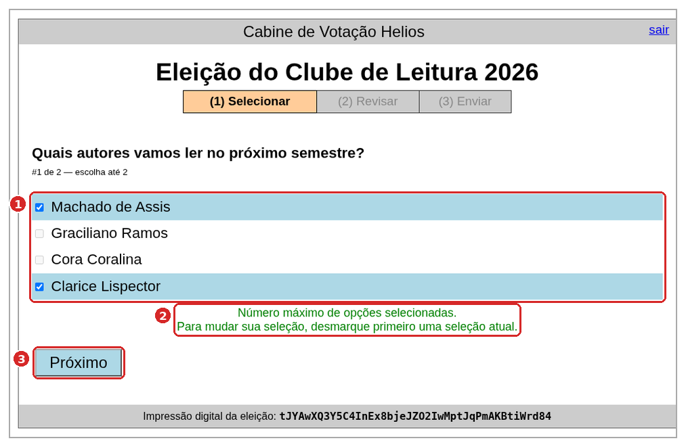

# 🗳️ Helios em português (helios-ptbr)

Tradução para o português do Brasil do [Helios](https://github.com/benadida/helios-server), o sistema de votação verificável de ponta a ponta criado por Ben Adida, com manuais por papel e uma instalação pronta em Docker Compose.



> [!IMPORTANT]
> **Tradução não oficial.** Este repositório é um fork de [benadida/helios-server](https://github.com/benadida/helios-server) e não tem ligação com o projeto original. O código de votação e de criptografia é o do Ben. Os textos, os manuais e a instalação em Docker são deste fork. Cada instituição deve conferir as regras de eleição e de proteção de dados que valem para ela.


## Por que existe

O Helios é usado em eleições de universidades, associações e conselhos, mas todo o sistema é em inglês. Quem vota, quem gere a eleição e quem guarda a chave precisam entender cada passo para confiar no resultado. Este projeto leva o Helios e a sua documentação ao português do Brasil, para que a verificação do voto seja compreensível para quem participa da eleição.

## Missão, visão e valores

**Missão.** Tornar o Helios acessível em português do Brasil: interface, e-mails, manuais e instalação, de modo que quem vota, quem gere e quem apura uma eleição entenda o que está fazendo.

**Visão.** Que instituições de língua portuguesa possam fazer eleições online em que a confiança no resultado venha da verificação, e não da fé em quem opera o servidor.

**Valores.**
- **Transparência:** tudo o que se confere em uma eleição é publicado. As escolhas de tradução também: o [diário](docs/diario.md) registra cada decisão e o motivo.
- **Clareza:** textos simples, com um vocabulário só, definido no [glossário](docs/glossario.md).
- **Honestidade sobre os limites:** o que o Helios garante e o que não garante está dito, sem exagero.
- **Fidelidade ao original:** a criptografia e a lógica de votação são as do projeto de Ben Adida. A tradução não as altera.

## O que é o Helios

Em uma eleição no Helios, o eleitor vota em um navegador, e o voto sai cifrado de lá. O servidor recebe só a cédula cifrada, e os votos nunca são abertos um a um: só o total é decifrado. Qualquer pessoa pode conferir que o resultado confere com as cédulas depositadas, sem precisar de senha.

Quatro papéis aparecem em toda eleição:

| Papel | O que faz |
|---|---|
| **Gestor** | Cria a eleição, as questões e a lista de eleitores, e libera o resultado |
| **Eleitor** | Vota, deposita a cédula e confere o próprio voto |
| **Apurador** | Guarda uma parte da chave e a usa para abrir o resultado |
| **Fiscal** | Verifica que a eleição foi honesta, sem precisar de senha |

## Os pilares de uma eleição

Qualquer eleição, em papel ou digital, precisa de quatro coisas ao mesmo tempo. O difícil é que elas puxam em direções opostas.

| Pilar | Pergunta que responde | No Helios |
|---|---|---|
| **Elegibilidade** | Só quem pode votar vota, e cada pessoa vota uma vez? | Lista de eleitores e login. Quem vota de novo substitui a cédula anterior. |
| **Sigilo** | Ninguém sabe em quem eu votei? | A cédula é cifrada no navegador. Só o total é decifrado, com a chave dos apuradores. |
| **Integridade** | O resultado é a soma dos votos depositados? | Cada passo da apuração tem uma prova que qualquer pessoa confere. |
| **Verificabilidade** | Posso conferir isso por conta própria? | Código de rastreamento, auditoria da cédula e verificadores públicos. |

Em papel, o sigilo vem da cabine fechada e a verificabilidade vem de os fiscais verem a urna e a contagem. Em uma eleição digital, ninguém vê nada com os próprios olhos, e a conferência passa a vir da matemática. Por isso a criptografia faz parte do desenho, e não é enfeite.

### Eleições digitais: o que muda

- **A cabine é o dispositivo do eleitor.** Um computador com vírus pode mudar o voto antes de cifrar. O Helios reduz o risco com a **auditoria da cédula**: o eleitor pode pedir que a cabine revele como cifrou, e conferir que as escolhas estão certas.
- **Não há urna física para recontar.** No lugar dela, a lista pública de cédulas cifradas e as provas.
- **A coação não some.** Em um voto feito fora de um local supervisionado, alguém pode pressionar a pessoa a votar de certa forma. O Helios não protege contra isso. Por isso ele serve melhor para eleições em que esse risco é baixo.

### Homomorfismo, em linguagem simples

O truque central do Helios tem um nome difícil, **cifragem homomórfica**, e uma ideia simples: dá para **somar votos sem abrir nenhum**.

Imagine que cada voto é um número em um cofre trancado: `1` para quem votou "Sim" e `0` para quem votou "Não". Ninguém abre o cofre. Mas existe uma operação especial que **junta dois cofres em um terceiro, cujo conteúdo é a soma dos dois**.

```
cofre(1)  +  cofre(0)  +  cofre(1)   =   cofre(2)
 voto Sim     voto Não     voto Sim       total de "Sim"
```

Só no fim, com as chaves dos apuradores, se abre **um único cofre**, o do total. Os votos individuais nunca são abertos.

Duas provas completam a ideia, ambas sem revelar nenhum voto:
1. **Cada cofre contém um voto válido** (só `0` ou `1`, e não `1000`). Sem isso, uma pessoa poderia trancar um número enorme e decidir a eleição sozinha.
2. **O cofre do total foi aberto corretamente** pelos apuradores.

Com isso, qualquer pessoa refaz a soma dos cofres públicos e confere se o resultado bate.

## O que este fork acrescenta

- **Interface em português do Brasil:** telas, e-mails, cabine de votação, verificadores, datas no fuso do navegador e plurais. Os textos seguem um [glossário](docs/glossario.md) e um [guia de estilo](docs/estilo.md).
- **Manuais por papel** com capturas de tela, em [`docs/pt-BR/`](docs/pt-BR/README.md).
- **Página de privacidade**, configurável por quem opera a instância, e uma página **"Tradução"** com o vocabulário e os créditos.
- **Instalação em Docker Compose** com HTTPS (Caddy), banco, processador de tarefas e Mailpit para testes, descrita em [`docs/docker.md`](docs/docker.md).

## Documentação

Escolha o seu papel:

| Papel | Manual |
|---|---|
| Gestor | [docs/pt-BR/gestor/](docs/pt-BR/gestor/README.md) |
| Eleitor | [docs/pt-BR/eleitor/](docs/pt-BR/eleitor/README.md) |
| Apurador | [docs/pt-BR/apurador/](docs/pt-BR/apurador/README.md) |
| Fiscal | [docs/pt-BR/fiscal/](docs/pt-BR/fiscal/README.md) |

Para quem opera e desenvolve:

- [Manual do usuário](docs/pt-BR/manual-do-usuario.md) e [Como o Helios funciona](docs/pt-BR/como-o-helios-funciona.md), em um arquivo só cada.
- [Docker Compose](docs/docker.md): instâncias, variáveis, HTTPS, e-mail e operação.
- [Privacidade](docs/privacidade.md): o que a instância guarda e como configurar o texto.
- [Diário do projeto](docs/diario.md): as decisões da tradução, com o motivo de cada uma.
- Em inglês, do projeto original: [User Manual](docs/user-manual.md), [How Helios Works](docs/how-helios-works.md), [Architecture](docs/architecture.md) e [Installation](INSTALL.md) (instalação sem Docker).

## Início rápido (Docker)

Precisa de Docker com o plugin Compose.

1. Clone o repositório e entre na pasta:

   ```bash
   git clone https://github.com/helios-ptbr/helios-server.git
   cd helios-server
   ```

2. Crie o `.env` com segredos novos. Exemplo de laboratório, nas portas 8443 e 8080:

   ```bash
   ./docker/gerar-env.sh teste localhost 8443 8080
   ```

3. Suba a instância, com o Mailpit para receber os e-mails de teste:

   ```bash
   docker compose --profile dev up -d --build
   ```

4. Abra `https://localhost:8443`. O navegador avisa do certificado autoassinado, e isso é esperado. Os e-mails de teste ficam em `http://localhost:8025`.

Para criar uma conta de gestor, use o comando `criar_administrador` descrito em [`docs/docker.md`](docs/docker.md).

> [!WARNING]
> O perfil `dev` e o Mailpit servem só para teste. Em uma eleição real, configure o envio de e-mail, o domínio e a [página de privacidade](docs/privacidade.md) da sua instituição.

## Implantação em produção

Use outro nome e o domínio da sua instituição, com as portas 443 e 80:

```bash
./docker/gerar-env.sh producao eleicoes.exemplo.br
docker compose up -d --build
```

Revise o `.env` (e-mail e aparência) antes de subir. Cada pasta com o seu `.env` é uma instância, e dá para rodar várias no mesmo computador. Todos os detalhes estão em [`docs/docker.md`](docs/docker.md).

## Testes

```bash
uv sync
uv run python manage.py compilemessages --settings=settings_ci
uv run python -Wall manage.py test --settings=settings_ci
uv run python -m unittest discover -s tools -p "test_*.py"
```

Os testes do Django precisam de um PostgreSQL em `localhost:5432` (ver `settings_ci.py`).

## Relação com o projeto original

Este repositório acompanha o [Helios do Ben Adida](https://github.com/benadida/helios-server). O código de votação e de criptografia é o dele, e a tradução, os manuais e o Docker ficam aqui. O passo a passo para trazer as novidades do projeto original está em [`docs/atualizar-upstream.md`](docs/atualizar-upstream.md).

## Como contribuir

Achou um texto estranho ou um erro de tradução? Abra uma [issue](https://github.com/helios-ptbr/helios-server/issues). Antes de propor uma troca de palavra, veja o [glossário](docs/glossario.md) e o [diário](docs/diario.md): muitas escolhas já têm motivo registrado.

## Licença e créditos

O Helios é de Ben Adida, sob a [Licença Apache 2.0](LICENSE), e esta tradução mantém a mesma licença. Veja o [CONTRIBUTORS.txt](CONTRIBUTORS.txt) para quem ajudou o projeto original e a página "Tradução" do próprio sistema para quem traduziu.
