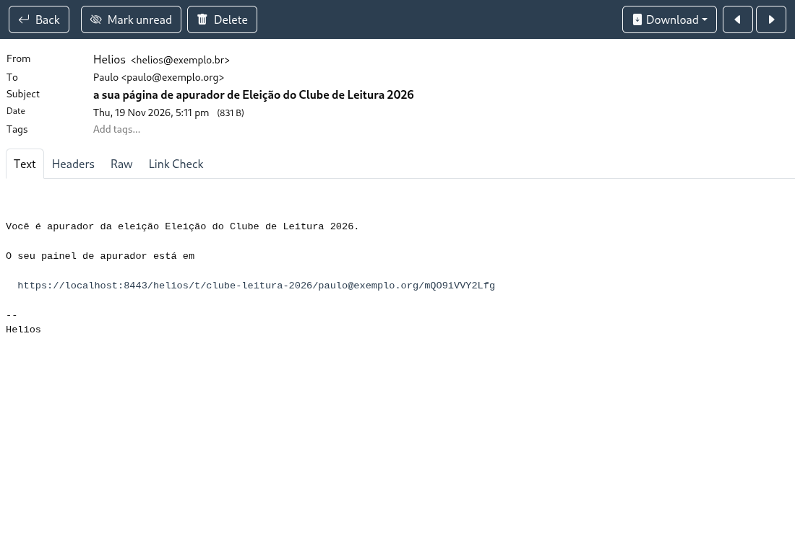
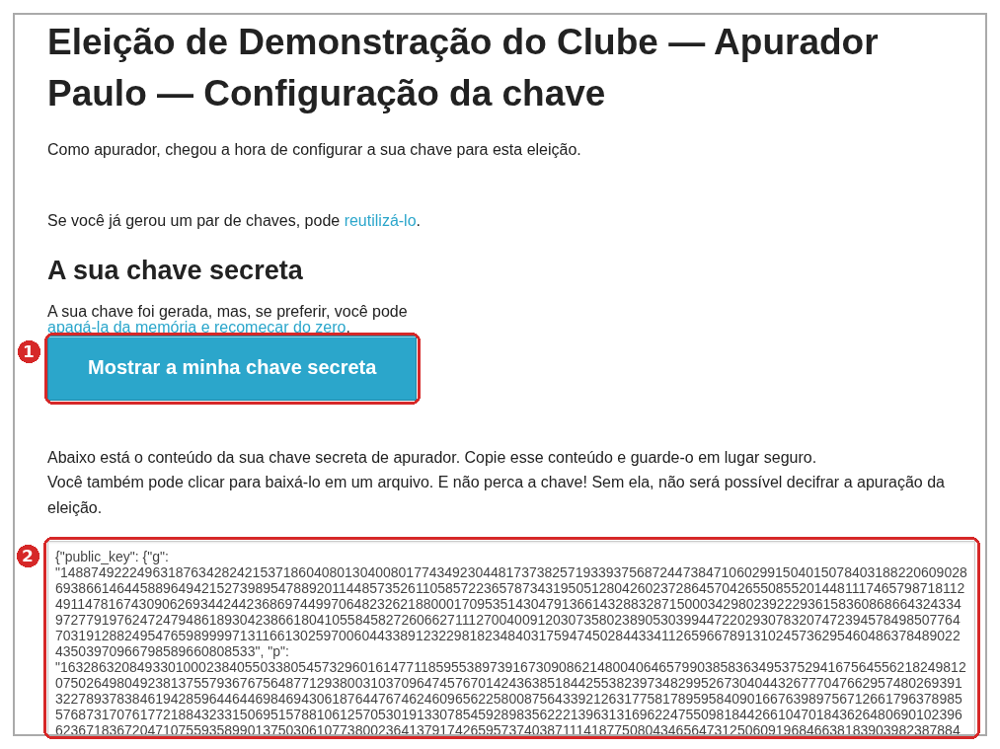

# Apurador 1: Receber o e-mail e gerar a chave

Este manual é para quem foi indicado como **apurador** de uma eleição.

**O que o apurador faz.** Ele guarda uma parte da chave que abre o resultado. Sem a parte de cada apurador, o resultado não abre. O Helios não guarda a sua chave secreta. Só você a tem.

Leia antes: o Helios **não tem quórum**. Veja [o que acontece se a chave se perder](02-guardar-a-chave.md).

## 1. O e-mail

O gestor da eleição envia a você um e-mail. O assunto é **a sua página de apurador de _nome da eleição_**. O texto diz que você é apurador da eleição e traz um link, o seu painel.

**Guarde esse e-mail.** O link dele é o que dá acesso ao seu painel. Você vai precisar dele de novo na hora da apuração.

## 2. Gerar a chave

1. Abra o link do e-mail. Você chega ao painel **Página inicial do apurador _nome_**.
2. Clique em **configurar a sua chave**.
3. O navegador gera o par de chaves **no seu computador**. A chave secreta não passa pelo servidor.
4. A tela mostra a **chave secreta da sua eleição**. Ela é um texto longo.
5. **Copie esse texto e guarde em lugar seguro.** Você também pode baixá-lo em um arquivo.
6. A tela mostra a **impressão digital** da sua chave pública. Anote-a. A chave pública não precisa ser guardada, porque a impressão digital basta para conferir.
7. Envie a chave pública. Isso é só um botão, e o servidor guarda a chave pública. Ela é a parte que todos podem ver.

**A tela não mostra a chave secreta de novo.** Se você fechar a página sem guardar, a chave se perdeu.

## 3. Conferir a chave

Confira agora, não na hora da apuração.

1. Volte ao painel e clique em **verificar que você tem a chave secreta certa**.
2. Cole a chave secreta no campo.
3. Se estiver certa, a tela diz **a sua chave secreta confere!**.
4. Se estiver errada, a tela diz **Ops, a sua chave está errada.** Procure a chave certa antes de seguir.

Faça essa conferência depois de guardar a chave, de preferência a partir da cópia que você guardou. Assim você sabe que a cópia funciona.

## Dúvidas comuns

**Posso gerar a chave de novo?** Não. Se você já enviou a chave pública, o gestor precisa remover você e criar outro apurador, e isso só vale antes de congelar a eleição.

**O servidor viu a minha chave secreta?** Não. Ela é gerada no navegador e só você a guarda.

**Perdi o e-mail com o link.** Peça ao gestor para reenviar o link do seu painel.

**Posso usar qualquer computador?** Sim, mas a chave secreta fica nele, no momento em que aparece. Copie-a para um lugar seguro antes de sair.

Voltar ao [índice do apurador](README.md).
