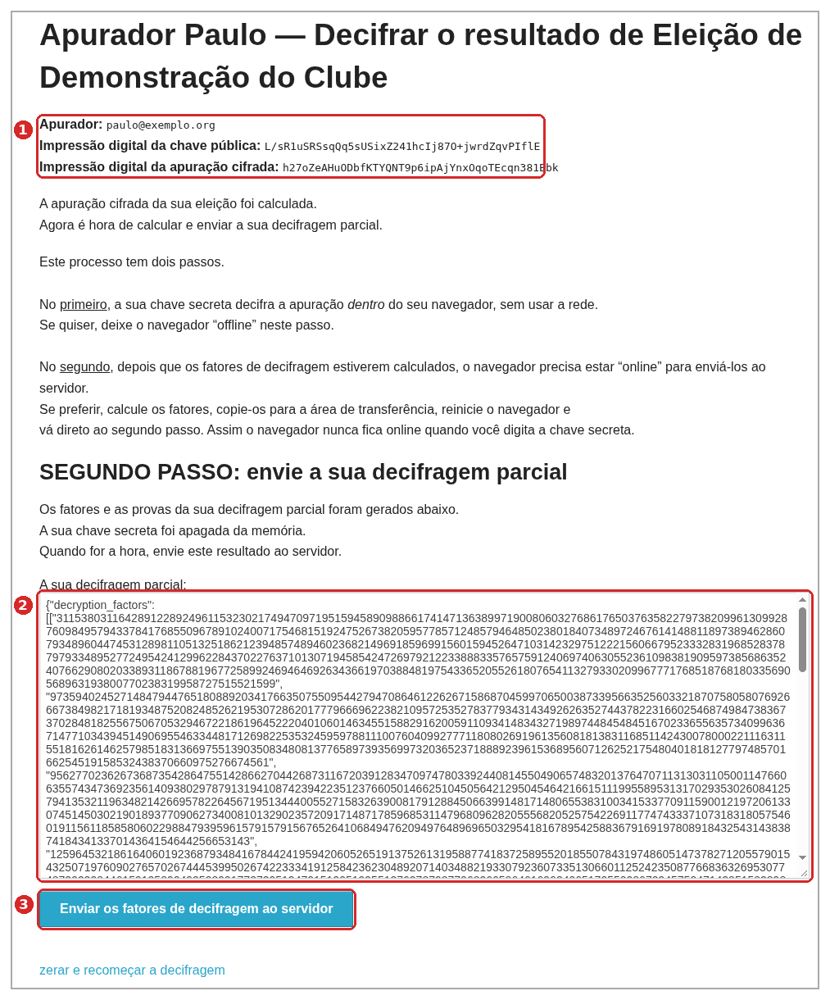

# Apurador 3: Decifrar na hora da apuração

Depois que a votação termina, o gestor calcula a **apuração cifrada**. Nesse momento cada apurador precisa fazer a sua parte. Só depois que todos fizeram, o gestor combina as decifragens e libera o resultado.

## O que você precisa ter

- O **e-mail com o link** do seu painel.
- A sua **chave secreta**, copiada do lugar onde você guardou.

## Passo a passo

1. Abra o link do e-mail. O painel mostra: **A apuração cifrada desta eleição está pronta.**
2. Clique em **decifrar com a sua chave**.
3. A página mostra três dados: o seu e-mail, a **impressão digital da chave pública** e a **impressão digital da apuração cifrada**. Confira se a impressão digital da sua chave é a que você anotou.
4. **Primeiro passo: digite a sua chave secreta.** Cole a chave no campo e clique em **Gerar a decifragem parcial**. O navegador calcula a sua parte e a prova de que ela está certa. Nada sai do computador ainda.
5. **Segundo passo: envie a sua decifragem parcial.** A tela mostra o resultado do cálculo. Clique em **Enviar os fatores de decifragem ao servidor**.
6. O servidor confere a prova. Se tudo estiver certo, a tela diz **Pronto!**.

*Na imagem: (1) Impressões digitais da chave pública e da apuração cifrada. (2) Decifragem parcial. (3) **Enviar os fatores de decifragem ao servidor**.*

Seu painel passa a dizer que você já enviou a decifragem.

## Se algo der errado

| Mensagem | O que fazer |
|---|---|
| **Erro: a sua chave secreta provavelmente está errada** | A chave colada não é a da eleição. Cole a chave completa. Confira antes com o botão de conferir a chave |
| **A verificação falhou, você provavelmente usou a chave errada** | Mesmo caso: use a chave certa |
| Nada acontece depois de clicar | Espere. O cálculo pode levar alguns segundos |

Para zerar e recomeçar, use **zerar e recomeçar a decifragem**.

## Para quem quer mais cuidado

O Helios permite separar os dois passos. Você pode gerar a decifragem em um computador sem rede e levar só o resultado para o segundo passo. Assim, a chave secreta nunca fica em um navegador conectado. No primeiro passo, use **ir direto ao segundo passo** em outro computador, e cole a decifragem que gerou.

## Depois

Quando todos os apuradores enviarem, o gestor combina as decifragens e libera o resultado. Você não precisa fazer mais nada. Se um apurador ainda não decifrou, a eleição espera. Veja [o que acontece se a chave se perder](02-guardar-a-chave.md).

## Dúvidas comuns

**O servidor vê a minha chave?** Não. O cálculo da decifragem acontece no seu navegador.

**Quanto tempo leva?** Segundos, mesmo com muitos votos. Na nossa medição, cada decifragem levou cerca de 0,12 s, e não dependeu do número de apuradores.

**Preciso estar no computador de sempre?** Não. Basta o link e a chave.

**Decifrei duas vezes por engano.** Depois do primeiro envio, o painel só diz que a decifragem foi enviada e não mostra mais o link para decifrar. Não há o que repetir.

Voltar ao [índice do apurador](README.md).
