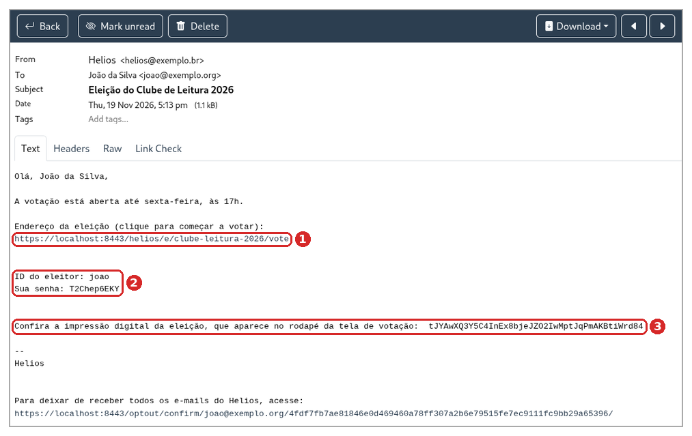

# Eleitor 1: Receber o e-mail e entrar

Este manual é para quem vai votar. Você não precisa instalar nada. Só precisa de um navegador atual.

## 1. O e-mail da eleição

Quando a votação abre, a administração envia um e-mail para você. Ele tem este formato:

```
Olá, João da Silva,

A votação está aberta até sexta-feira, às 17h.

Endereço da eleição (clique para começar a votar):
https://votacao.exemplo.org/helios/e/clube-leitura-2026/vote

ID do eleitor: joao
Sua senha: usyWtLo2yW

Confira a impressão digital da eleição, que aparece no rodapé da tela de votação: tJYAwXQ3Y5C4I...
```



*Na imagem: (1) Endereço da eleição. (2) **ID do eleitor** e **Senha**. (3) Impressão digital da eleição.*

O e-mail traz três coisas:
- **O link da eleição.** Ele abre a cabine de votação.
- **O seu ID do eleitor.**
- **A sua senha.**
- **A impressão digital da eleição.** Ela também aparece no rodapé da cabine. Compare as duas: se forem iguais, você está na eleição certa.

**Guarde o e-mail até o fim da votação.** Você precisa do ID e da senha para depositar a cédula.

Algumas eleições pedem que você entre com uma conta externa, como a da instituição ou do Google. Nesse caso, o e-mail não traz senha, e você entra com a sua conta na hora de depositar.

## 2. Quando você entra

Você não entra no Helios para preencher a cédula. A cabine abre sem login. O login só é pedido **no fim**, na hora de depositar a cédula (veja o [manual 2](02-votar-e-depositar.md)).

Assim, você pode preencher a cédula, ver o resumo e só então se identificar.

## 3. Se algo não funcionar

| Problema | O que fazer |
|---|---|
| O e-mail não chegou | Olhe a caixa de spam. Se não estiver lá, peça à administração para reenviar |
| Perdi a senha | Na tela de depositar, clique em **Esqueceu a senha? Clique aqui para receber de novo.** A senha chega por e-mail |
| O link não abre | Confira se copiou o endereço inteiro. Se continuar, avise a administração |
| "Você não tem direito a votar nesta eleição" | A conta usada para entrar não está na lista de eleitores. Fale com a administração |

## Dúvidas comuns

**Posso votar pelo celular?** Sim, em um navegador atual. O computador dá mais espaço para ler as opções.

**Alguém mais vê o meu voto?** Não. A cédula é cifrada no seu navegador antes de sair dele. A administração vê quem votou, mas não em quem.

**Posso votar de novo?** Sim, enquanto a votação estiver aberta. Só vale a última cédula.

Voltar ao [índice do eleitor](README.md).
