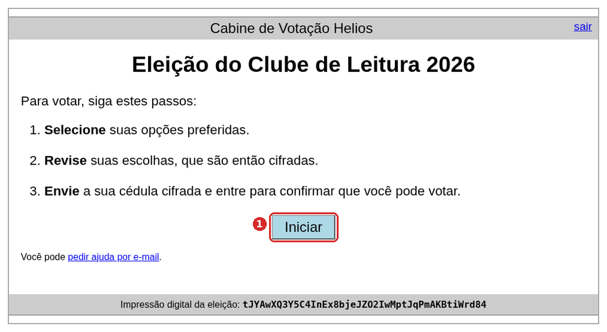
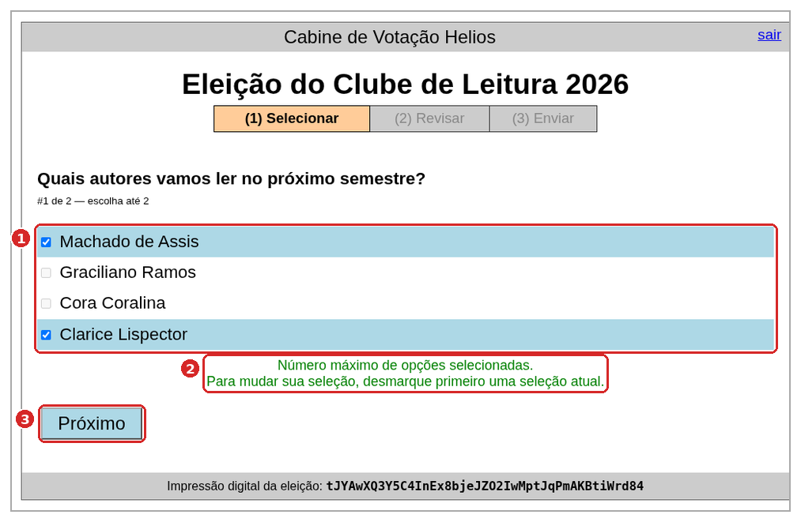
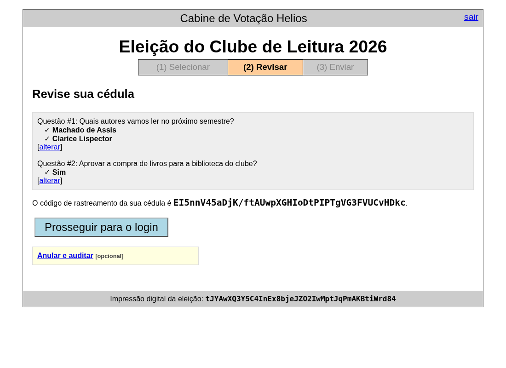
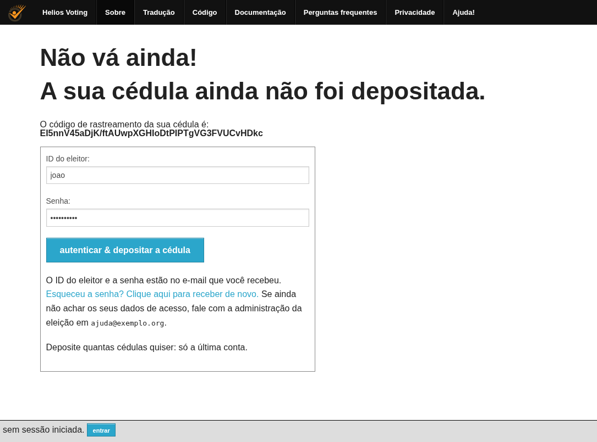
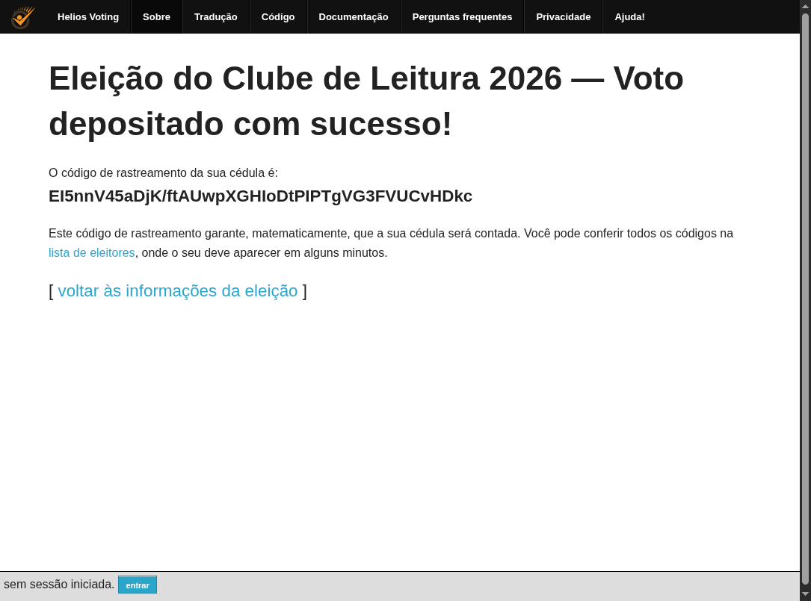

# Eleitor 2: Votar e depositar a cédula

Votar tem três etapas: preencher, revisar e depositar. A cédula só vale depois de depositada.

## 1. Preencher a cédula

1. Clique no link do e-mail. A cabine de votação abre.
2. Clique em **Iniciar**.
3. Em cada questão, marque as opções. A cabine diz quantas você pode escolher, por exemplo "Escolha entre 0 e 2 opções".
4. Clique em **Próximo**. Na última questão, o botão é **Prosseguir**.

**Voto em branco.** Se a questão aceita "0" no mínimo (por exemplo "entre 0 e 2"), você pode avançar **sem marcar nada**. Isso vale como voto em branco naquela questão. Se o mínimo é 1, a cabine não deixa avançar sem marcar.

**Não dá para marcar mais que o máximo.** A cabine bloqueia.

**Ordem das opções.** Em algumas questões, as opções aparecem em ordem diferente para cada eleitor. Isso é proposital.

## 2. Revisar e cifrar

1. A cabine mostra as suas escolhas. Para corrigir uma questão, clique em **[alterar]**.
2. Em seguida, o navegador **cifra** a cédula. Isso leva alguns segundos.
3. Aparece o seu **código de rastreamento**, um texto longo como `Ag/lQORWPk...`.
4. **Anote o código** (ou deixe a página aberta). Ele é a prova de que a sua cédula foi registrada.
5. Clique em **Prosseguir para o login**.

Se você quiser conferir que a cabine cifrou as suas escolhas sem erro, use **Anular e auditar**. Isso descarta esta cédula. Veja o [manual 3](03-auditar.md).

## 3. Depositar

A cédula ainda **não foi depositada**.

1. Digite o **ID do eleitor** e a **senha** do e-mail.
2. Clique em **autenticar e depositar a cédula**.

Se a eleição pede conta externa, entre com ela e clique em **DEPOSITAR esta cédula**.

## 4. Pronto

Você vê **Voto depositado com sucesso!** e o seu código de rastreamento. O Helios também envia o código por e-mail.

**Guarde o código de rastreamento.** Ele serve para [conferir a sua cédula](04-conferir.md).

## Votar de novo

Enquanto a votação está aberta, você pode repetir tudo. A cédula nova **substitui** a anterior. O Helios usa a última. Cada cédula depositada gera um código novo.

## Dúvidas comuns

**Fechei a página antes de depositar.** A cédula não foi depositada. Abra o link do e-mail e preencha de novo.

**Fechei a página depois de depositar.** Está tudo certo. O código de rastreamento foi enviado por e-mail.

**Errei o voto.** Se a votação ainda está aberta, vote de novo.

**O Helios me mostra o resultado?** Só quando a administração libera o resultado, depois da apuração.

Voltar ao [índice do eleitor](README.md).
