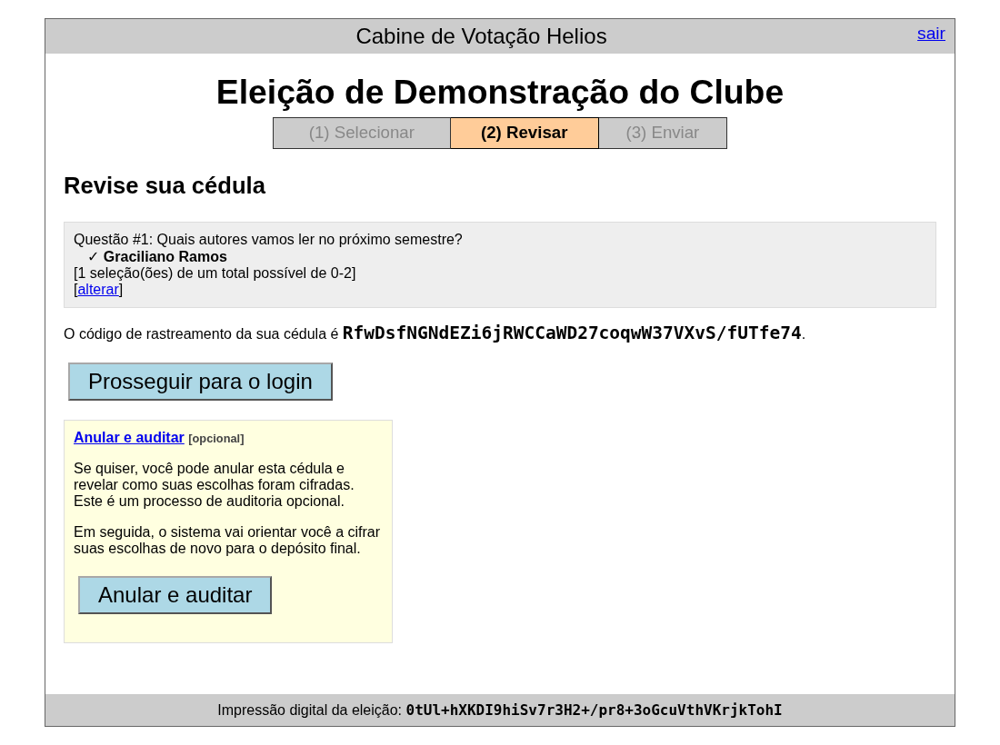
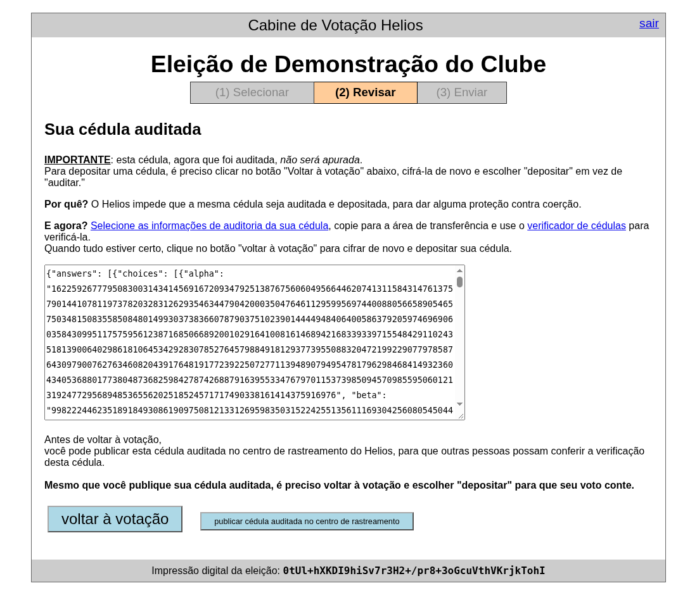
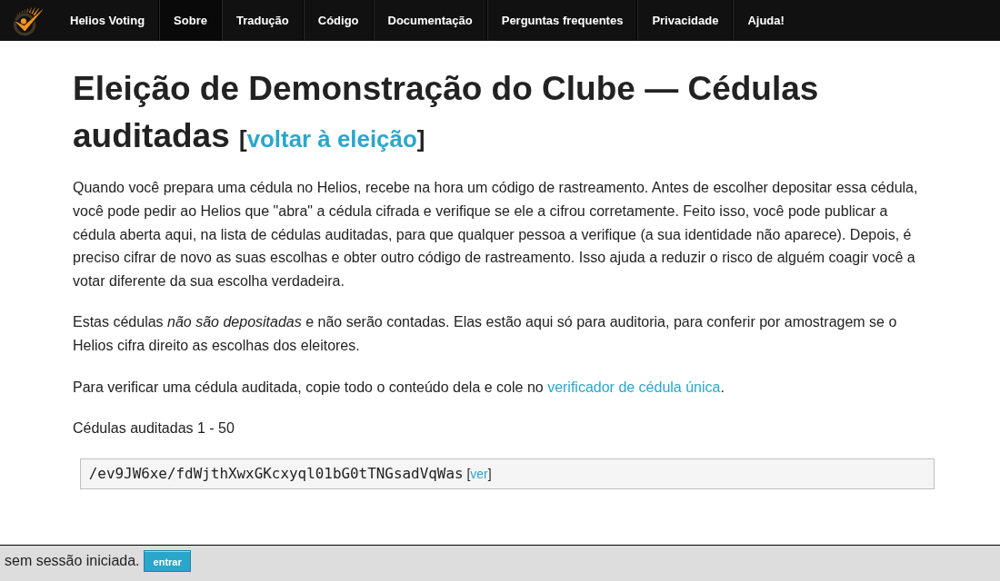

# Eleitor 3: Auditar a cédula (anular e conferir)

Esta etapa é **opcional**. Ela serve para conferir que a cabine cifrou as suas escolhas do jeito certo, sem trocar nenhum voto.

## Como funciona

O navegador cifra a cédula com números aleatórios. Se você pedir uma **auditoria**, o navegador mostra esses números. Com eles, qualquer verificador refaz a cifragem e confere se ela bate com as suas escolhas.

**A cédula auditada é descartada.** Ela nunca vale como voto. Depois da auditoria, você preenche e cifra uma cédula nova, e essa é a que você deposita.

## Passo a passo

1. Preencha a cédula normalmente (veja o [manual 2](02-votar-e-depositar.md)).
2. Na tela de revisão, procure a caixa amarela **Anular e auditar [opcional]**.
3. Clique no link **Anular e auditar**. A caixa abre e explica o que vai acontecer.
4. Clique no botão **Anular e auditar**. A cabine mostra a **cédula auditada**: o aviso de que ela não será apurada, as suas escolhas, os números aleatórios usados e o texto cifrado.
5. Clique em **Selecione as informações de auditoria da sua cédula** e copie o texto.
6. Abra o **verificador de cédulas** (o link está na própria tela) e cole as informações. Veja o [manual do fiscal](../fiscal/02-cedula-e-descartadas.md). Se tudo bate, a tela diz **Cifragem verificada** e **VERIFICAÇÃO CONCLUÍDA COM SUCESSO!**
7. Se não bater, a tela diz **PROBLEMA = a cifragem não confere**. Avise a administração e não deposite essa cédula.
8. Volte à cabine. Ela começa uma cédula nova, e você pode votar de verdade.

## Publicar a cédula auditada (opcional)

A cabine oferece **publicar cédula auditada no centro de rastreamento**. Se você publicar, qualquer pessoa pode ver essa cédula na página **Cédulas auditadas** da eleição.

**Atenção:** a cédula auditada mostra as suas escolhas, em texto claro. Publique só se estiver tudo bem em as escolhas dessa cédula ficarem públicas. Como ela foi descartada, não é o seu voto verdadeiro, e você pode fazer a auditoria com escolhas de teste.

## Por que auditar?

O Helios não pede que você confie na cabine. Cada pessoa pode auditar quantas cédulas quiser. Se a cabine tentasse trocar um voto, a auditoria acabaria por pegar o erro. É por isso que quem audita faz a eleição mais confiável para todos, mesmo sem ser o seu voto verdadeiro.

## Dúvidas comuns

**Posso auditar e depois votar?** Sim. Você pode auditar quantas vezes quiser.

**A auditoria conta como voto?** Não. A cédula auditada é descartada.

**O que faço com as informações de auditoria?** Cole no verificador de cédula única. Se não for conferir, pode ignorar.

**É obrigatório?** Não. Só quem quer conferir faz.

Voltar ao [índice do eleitor](README.md).
