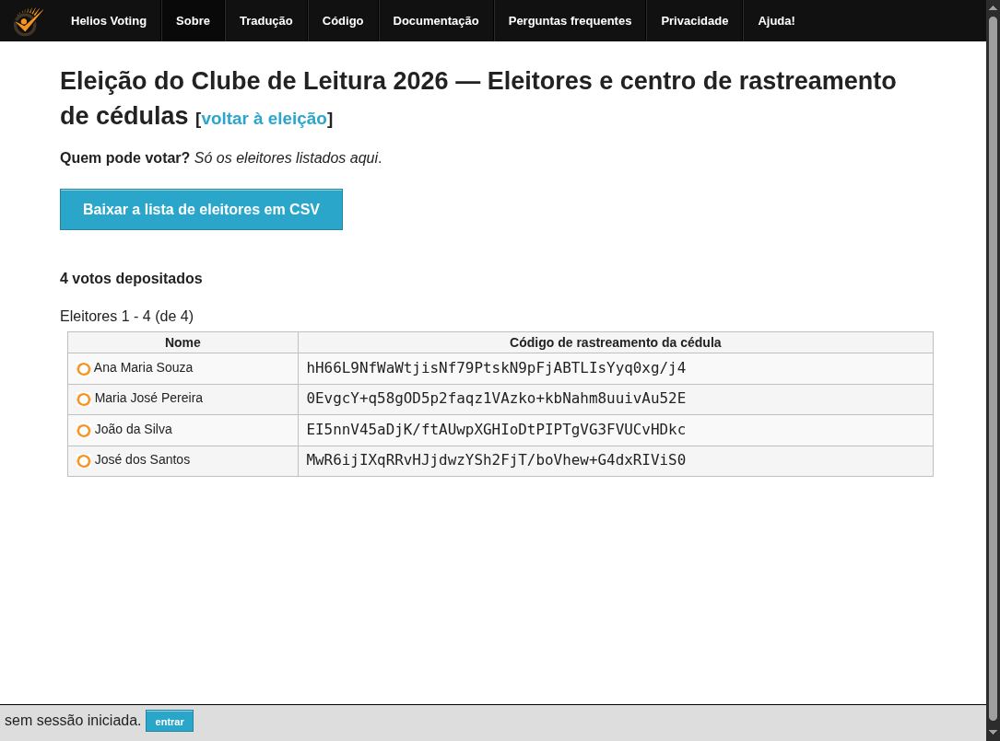

# Eleitor 4: Conferir a sua cédula e a lista de eleitores

Depois de depositar, você pode conferir que o Helios registrou a sua cédula e que o seu nome está na lista de quem votou.

## 1. Conferir a sua cédula

1. Abra a página da eleição e clique em **eleitores e cédulas**. O título é **Eleitores e centro de rastreamento de cédulas**.
2. Procure o seu nome (ou o seu apelido, se a eleição usa apelidos).
3. Ao lado dele, a coluna **Código de rastreamento da cédula** mostra o seu código. Quem ainda não votou aparece com um traço (—). O código pode levar alguns minutos para aparecer.
4. Compare com o que você anotou ou recebeu por e-mail. Se for igual, **a sua cédula foi registrada como você a depositou**.

Se o código for **diferente**, ou se não aparecer depois de um tempo longo, avise a administração.

**Você pode conferir também** o código em um endereço direto. Quem tem o seu código pode abrir a cédula cifrada, mas não consegue ver as suas escolhas.

## 2. A lista de eleitores

A mesma página mostra, para cada eleitor:
- o **nome** (ou apelido);
- se **já votou** (tem código, ou um traço se não votou);
- o **código de rastreamento** da cédula.

A lista é pública, a menos que a eleição seja privada. Em eleições com apelidos, a lista mostra o apelido e esconde o nome. Ela mostra **quem votou** (quem tem código), mas **não mostra em quem** votou. A cédula está cifrada.

Com a lista, qualquer um confere:
- quantas pessoas votaram;
- que o total de códigos confere com o total de cédulas.

## 3. Cédulas auditadas

A página **Cédulas auditadas** lista as cédulas que as pessoas auditaram e publicaram. Elas não valem como voto. Servem para mostrar que a cabine cifra certo.

## 4. Depois da apuração

Quando a administração libera o resultado:
1. A página da eleição mostra o resultado.
2. Você pode pedir ao [fiscal](../fiscal/README.md) ou conferir por conta própria, no verificador da eleição inteira, que a soma está certa.

## Dúvidas comuns

**O meu código não aparece.** Pode levar alguns minutos. Se a eleição usa uma fila de verificação, espere e atualize a página.

**Alguém consegue ver o meu voto pelo código?** Não. O código é um resumo da cédula cifrada, e não revela as escolhas.

**Votei duas vezes. Qual aparece?** O último código. Os anteriores ficam registrados na eleição, mas só a última cédula conta.

**Posso conferir sem entrar?** Sim, em eleições que não são privadas.

Voltar ao [índice do eleitor](README.md).
