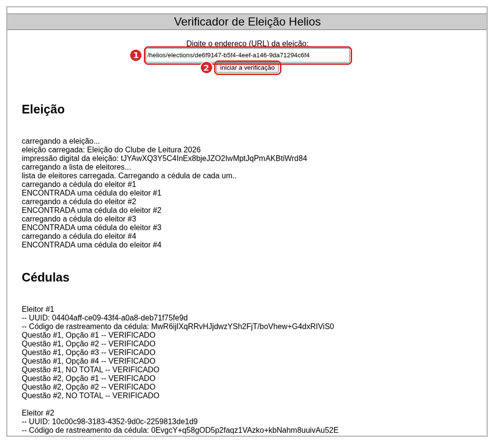
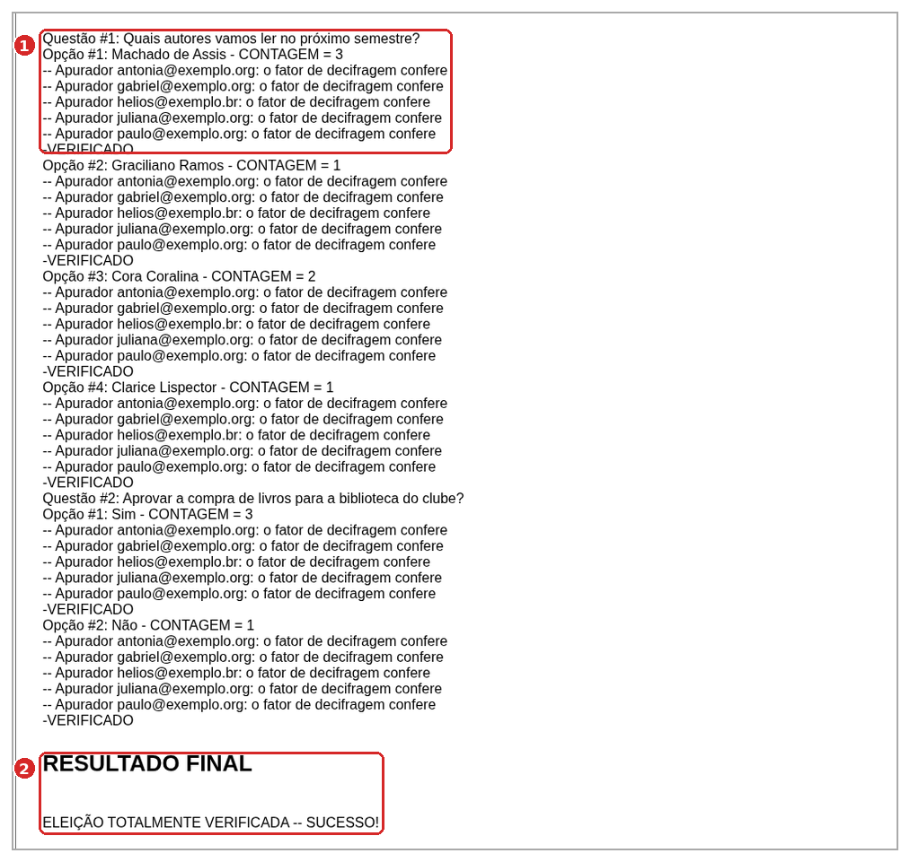

# Fiscal 1: Verificar a eleição inteira

O fiscal confere que a eleição foi honesta, sem precisar confiar na administração nem no servidor. Você não precisa de senha: só dos endereços públicos da eleição. (Em eleição privada, entre como eleitor cadastrado ou como administrador.)

## O que o verificador confere

O verificador de eleição baixa os dados públicos da eleição e refaz as contas no seu navegador. Ele confere:

| Etapa | O que a tela mostra |
|---|---|
| A eleição | Carrega a eleição e mostra a **impressão digital da eleição** |
| Os eleitores e as cédulas | Carrega a lista de eleitores e a cédula de cada um, com o **código de rastreamento** |
| As provas das cédulas | Cada cédula tem prova de que as escolhas respeitam os limites da questão |
| Os apuradores | Confere a **chave pública** de cada apurador e que a chave da eleição foi **formada corretamente** |
| A apuração | Soma as cédulas cifradas e confere que o resultado bate |
| As decifragens | Confere que o **fator de decifragem** de cada apurador está certo |
| O final | Mostra **ELEIÇÃO TOTALMENTE VERIFICADA -- SUCESSO!** ou **A VERIFICAÇÃO FALHOU** |

Se qualquer etapa falhar, a tela mostra **PROBLEMA** ou **ERRO** na linha em que falhou.

## Passo a passo

1. Abra a página da eleição. Clique em **Informações de auditoria** (o texto fica recolhido). Ali estão o **endereço da eleição** e a **impressão digital da eleição**.
2. **Anote a impressão digital.** Ela só aparece depois que a eleição é congelada. Se ela mudar depois, a eleição foi alterada.
3. Depois que o resultado é liberado, a página da eleição mostra a frase "verifique a apuração da eleição", com o link no texto "apuração da eleição". Clique nele. O verificador abre em outra aba, com o endereço já preenchido.
4. Clique em **iniciar a verificação**.
5. Espere. O navegador baixa uma cédula por eleitor, e isso leva mais tempo em eleições grandes.
6. Leia o fim. O resultado certo é **ELEIÇÃO TOTALMENTE VERIFICADA -- SUCESSO!**

*Na imagem: (1) Endereço da eleição. (2) **iniciar a verificação**.*

*Na imagem: (1) Contagens e fatores de decifragem de cada apurador. (2) Resultado final.*

## O que olhar além do verificador

Na mesma página, em **Informações de auditoria**, há dois links:

- **Centro de rastreamento de cédulas.** Lista cada eleitor e o código da sua cédula. Compare o total de códigos com o total de cédulas. Veja o [manual do eleitor 4](../eleitor/04-conferir.md).
- **Cédulas auditadas.** Lista as cédulas que as pessoas descartaram para conferir a cabine. Veja o [manual 2](02-cedula-e-descartadas.md).

## O que a verificação prova e o que não prova

**Prova:**
- Que as cédulas têm provas matemáticas válidas.
- Que o resultado é a soma das cédulas cifradas que estão na lista.
- Que cada apurador decifrou certo.

**Não prova:**
- Que a lista de eleitores é a correta. Compare-a com a lista da instituição.
- Que o eleitor conferiu o seu código. Isso depende de cada eleitor.
- Que o seu computador e o seu navegador são de confiança.

## Dúvidas comuns

**O verificador diz que a eleição não usa a apuração homomórfica simples.** Esse tipo de eleição o Helios não verifica ainda.

**A verificação falhou. E agora?** Anote as linhas com **ERRO** e avise a administração. Guarde a impressão digital e o endereço da eleição.

**Posso verificar mais de uma vez?** Sim, quantas vezes quiser. Uma verificação depois do resultado e outra dias depois mostram que nada mudou.

**Demorou muito.** O navegador baixa e confere cada cédula. Em eleições grandes, deixe a aba aberta.

Voltar ao [índice do fiscal](README.md).
