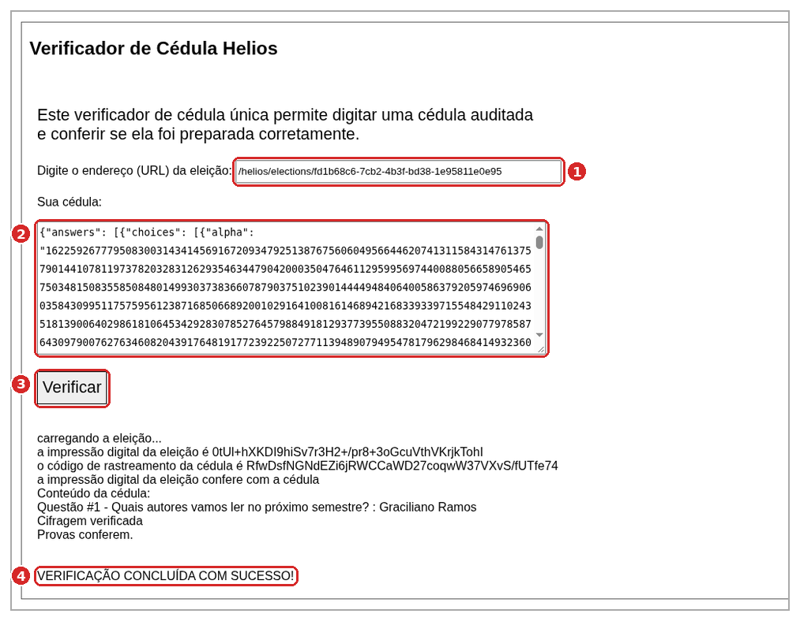
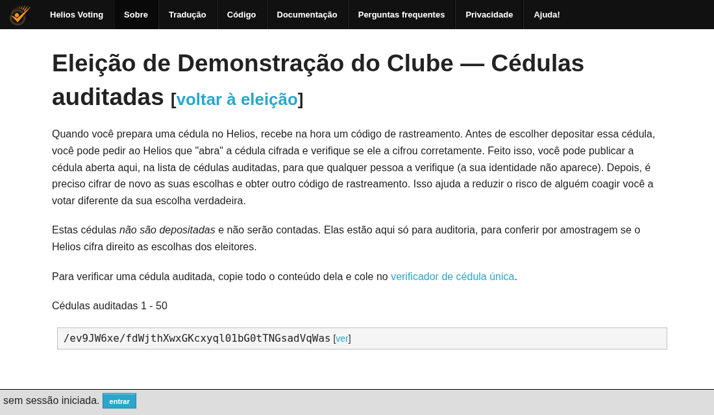

# Fiscal 2: Verificar uma cédula e as cédulas descartadas

Este manual tem duas partes: conferir **uma cédula auditada** no verificador de cédula única, e conferir **as cédulas descartadas** da eleição.

## Por que existem cédulas descartadas

Quem vota pode **anular e auditar** uma cédula na cabine (veja o [manual do eleitor 3](../eleitor/03-auditar.md)). A cabine mostra os números aleatórios da cifragem, e a cédula é descartada. Ela não conta como voto.

Se a cabine tentasse trocar um voto, a auditoria pegaria o erro. Por isso, quanto mais cédulas são auditadas, maior a confiança.

## 1. Verificar uma cédula auditada

Você precisa de duas coisas: o **endereço da eleição** e as **informações de auditoria** da cédula.

1. Abra o verificador de cédula única em `/helios/elections/single_ballot_verifier`, no endereço do seu servidor.
2. Em **Digite o endereço (URL) da eleição**, cole o endereço da eleição. Você o encontra em **Informações de auditoria**, na página da eleição.
3. Em **Sua cédula**, cole as informações de auditoria. Elas vêm de um destes lugares:
   - da **sua própria auditoria**, na cabine;
   - da página **Cédulas auditadas** da eleição, que lista as cédulas que outras pessoas publicaram.
4. Clique em **Verificar**.
5. A resposta certa é **Cifragem verificada**. Se a tela mostrar **PROBLEMA = a cifragem não confere**, a cédula não foi cifrada como deveria.

Se der PROBLEMA, **guarde** as informações de auditoria, o endereço da eleição e a data. Avise a administração. Esse é o sinal que a auditoria existe para achar.

## 2. A página de cédulas auditadas

1. Na página da eleição, em **Informações de auditoria**, clique em **Cédulas auditadas**.
2. A página lista o **código de rastreamento** de cada cédula auditada que alguém publicou, com o link **ver**.
3. O link **ver** abre a cédula. Copie o conteúdo e use no verificador de cédula única.

A lista mostra **"nenhuma cédula auditada ainda"** quando ninguém publicou.

## 3. Conferir que as cédulas descartadas não foram contadas

Uma cédula auditada **não pode** estar na apuração. Para conferir:

1. Abra o **Centro de rastreamento de cédulas**. Ele lista os códigos das cédulas que **contam**.
2. Abra **Cédulas auditadas**. Ela lista os códigos das cédulas **descartadas**.
3. Compare. Nenhum código pode estar nas duas listas.

Se um código aparece nas duas, avise a administração e guarde os dois endereços.

## O que esta conferência prova

**Prova:**
- Que as cédulas auditadas que você verificou foram cifradas conforme as escolhas mostradas.
- Que as cédulas descartadas não entram na lista de cédulas que contam.

**Não prova:**
- Que **todas** as cédulas foram cifradas certo. Só as auditadas foram conferidas. A confiança vem de muita gente auditar.
- Que as cédulas que contam foram cifradas certo. Para isso, vale a verificação da [eleição inteira](01-verificar-eleicao.md).

## Dúvidas comuns

**Posso verificar a cédula de outra pessoa?** Só as cédulas auditadas e publicadas. A cédula que conta está cifrada e ninguém, nem você, consegue ver as escolhas.

**Posso publicar uma auditoria minha?** Sim. Faça a auditoria na cabine e publique. Use escolhas de teste, porque a cédula auditada mostra as escolhas em texto claro.

**Não há cédulas auditadas na eleição.** Isso é possível. Peça a pessoas de confiança para auditarem algumas antes do fim da votação.

Voltar ao [índice do fiscal](README.md).
