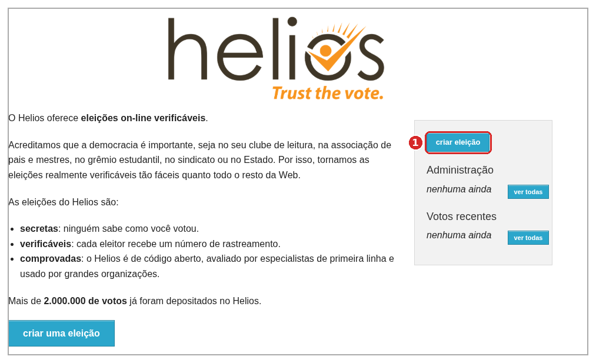
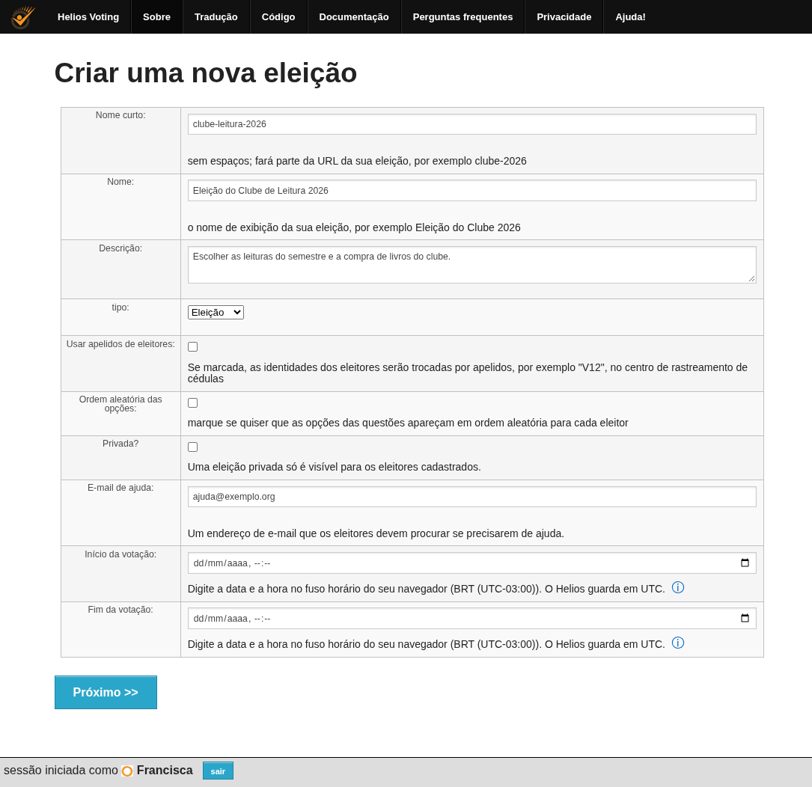

# Gestor 1: Criar a eleição

Este manual mostra como criar a eleição e como a página dela organiza o que vem depois. Os próximos passos estão nos outros manuais do gestor.

## O caminho inteiro

| # | Passo | Manual |
|---|---|---|
| 1 | Criar a eleição | este |
| 2 | Incluir as questões | [2. Questões](02-questoes.md) |
| 3 | Incluir os eleitores | [3. Eleitores](03-eleitores.md) |
| 4 | Incluir apuradores (opcional) | [apurador](../apurador/README.md) |
| 5 | Congelar a urna e abrir a eleição | [4. Congelar, acompanhar e encerrar](04-congelar-e-acompanhar.md) |
| 6 | Enviar e-mail aos eleitores | [3. Eleitores](03-eleitores.md) |
| 7 | Encerrar a votação e calcular a apuração | [4](04-congelar-e-acompanhar.md) e [5](05-apuracao-e-resultado.md) |
| 8 | Combinar as decifragens e liberar o resultado | [5. Apuração e resultado](05-apuracao-e-resultado.md) |

A página da eleição sempre mostra o **Próximo passo**. Se você se perder, volte a ela.

## 1. Entrar

Entre no seu servidor Helios. Depois do login, a página inicial mostra **criar eleição**, as eleições que você administra e as que você votou.

## 2. Criar a eleição

Clique em **criar eleição** e preencha o formulário.

| Campo | Para que serve |
|---|---|
| **Nome curto** | Uma palavra, sem espaços. Vira parte do endereço, por exemplo `/helios/e/clube-leitura-2026`. Não muda depois |
| **Nome** | O título que os eleitores veem |
| **Descrição** | O que os eleitores vão ler antes de votar |
| **Tipo** | **Eleição** ou **Consulta** |
| **Usar apelidos de eleitores** | A lista pública mostra apelidos (V1, V2...) no lugar dos nomes |
| **Ordem aleatória das opções** | Mostra as opções em ordem diferente para cada eleitor (vale para todas as questões) |
| **Privada?** | Só quem está na lista de eleitores vê a eleição |
| **E-mail de ajuda** | Para onde os eleitores pedem ajuda |
| **Início da votação / Fim da votação** | Opcionais. Veja abaixo |

Clique em **Próximo**.

### Datas de início e de fim

- Você digita a hora **do fuso do seu navegador**. O Helios converte para UTC e guarda assim.
- Sem data de início, a votação abre na hora em que você congela a urna.
- Sem data de fim, a votação fica aberta até você a encerrar.
- Com data de fim, você ainda pode **prorrogar a votação** (veja o [manual 4](04-congelar-e-acompanhar.md)).

### Eleição ou consulta

A diferença é o nome que aparece nos textos da eleição ("esta eleição" ou "esta consulta"). A contagem é a mesma.

### Apelidos de eleitores

Com apelidos, a lista pública mostra "V12" no lugar de "João da Silva". Isso esconde **quem** votou, mas só da lista pública. A administração continua vendo os nomes.

### Eleição privada

Numa eleição privada, só os eleitores da sua lista veem a eleição, e eles precisam entrar. Isso também vale para quem quer verificar a eleição (veja o [manual do fiscal](../fiscal/01-verificar-eleicao.md)).

## 3. O que muda depois do congelamento

Você pode mudar o formulário da eleição **antes** de congelar. Depois de congelada:
- as questões, as opções e os apuradores não mudam mais;
- a lista de eleitores ainda pode mudar, até a apuração começar.

Por isso, revise com calma antes de congelar.

## Dúvidas comuns

**Posso mudar o nome curto?** Não. Crie outra eleição, ou copie esta com **copiar eleição**, na página da eleição.

**Posso apagar a eleição?** Sim, pelo botão de apagar na página da eleição. Ela some para todos, menos para quem administra o servidor. Para só tirá-la da lista, use **arquivar**.

**Quem pode criar eleições?** Quem tem permissão no seu servidor. Se o botão **criar eleição** não aparece, peça a quem opera o servidor.

Voltar ao [índice do gestor](README.md).
