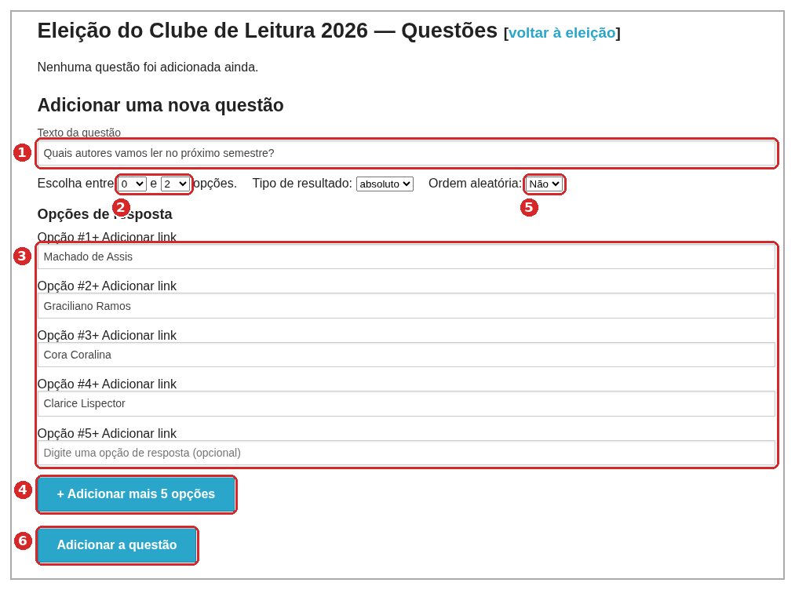

# Gestor 2: Questões, limites de escolha, voto em branco e nulo

Este manual mostra como montar as questões da eleição. Ele explica os limites "0 a n" e "1 a n", a ordem aleatória, e o que o Helios faz (e não faz) com voto em branco e voto nulo.

Você precisa estar logado como administrador da eleição, e a eleição ainda não pode estar congelada.

## 1. Incluir uma questão

1. Abra a eleição e clique em **questões**.
2. Em **Adicionar uma questão**, escreva o texto da questão.
3. Em **Escolha entre _X_ e _Y_ opções**, defina o mínimo e o máximo (veja a seção 2).
4. Em **Opções de resposta**, escreva uma opção por linha. Cada opção pode ter um link para mais informações (por exemplo, a biografia de quem se candidata). Clique em **Adicionar mais 5 opções** se precisar de mais campos.
5. Escolha **Ordem aleatória** (seção 3) e clique em **Adicionar a questão**.

Você pode editar, remover e reordenar as questões até congelar a eleição. Depois de congelar, nada muda.

## 2. Mínimo e máximo: "0 a n" e "1 a n"

O mínimo e o máximo dizem **quantas opções** o eleitor marca na mesma questão.

| Limite | O que o eleitor pode fazer | Exemplo |
|---|---|---|
| **1 a 1** | Marcar exatamente uma opção | Escolher um nome para a presidência |
| **0 a 1** | Marcar uma opção ou nenhuma | Presidência, aceitando voto em branco |
| **1 a n** | Marcar de 1 até n opções. Não pode depositar sem marcar | Escolher até 3 leituras do semestre |
| **0 a n** | Marcar de 0 até n opções. Pode depositar sem marcar | Escolher até 3 leituras, aceitando voto em branco |
| **Sem máximo** (deixe o máximo vazio) | Marcar quantas quiser, até todas | Aprovação livre de uma lista |

O Helios confere o limite de duas formas: a cabine impede o eleitor de passar do máximo, e o servidor confere uma prova matemática de que a soma das escolhas está entre o mínimo e o máximo. Uma cédula fora do limite é recusada.

## 3. Ordem aleatória

Com **Ordem aleatória: Sim**, a cabine mostra as opções em ordem diferente para cada eleitor. Isso evita que a primeira da lista ganhe vantagem. A ordem aleatória só muda o que o eleitor vê. A apuração não muda.

## 4. Voto em branco e voto nulo

**O Helios não tem voto em branco nem voto nulo como recurso próprio.** Ele só conhece o que está nos limites da questão. O que fazer em cada caso:

### Voto em branco: use "0 a n"

Para aceitar voto em branco, defina o **mínimo como 0**. O eleitor deposita a cédula **sem marcar nenhuma opção**. Isso é um voto em branco.

- O Helios aceita esse voto e ele conta como cédula depositada.
- O resultado não mostra o número de brancos. Ele mostra só os votos de cada opção. Para saber quantos votaram em branco, subtraia: cédulas depositadas menos as cédulas com ao menos uma marca. Se a instituição precisa do número de brancos no resultado, crie uma opção "Branco" (veja abaixo) em vez de depender dessa conta.
- Com **mínimo 1**, não há voto em branco. A cabine não deixa o eleitor avançar sem marcar.

### Voto nulo: não existe

O Helios não anula cédulas. Uma cédula que respeita o limite é válida e conta.

Se a regra da sua eleição pede voto nulo, a saída é criar uma opção chamada "Nulo" na lista. **Ela é uma opção como qualquer outra.** Isso traz um problema nas questões de "1 a n" com n maior que 1.

**O problema.** Numa questão de **1 a 3** com as opções A, B, C e "Nulo", uma pessoa marca **A, B e Nulo**. Para o Helios, isso é uma cédula válida: três marcas, dentro do limite. O resultado conta um voto para A, um para B e um para "Nulo". Pela regra de muitas instituições, essa cédula deveria ser anulada por completo. O Helios não faz isso.

Testamos esses casos no Docker, com uma questão de 4 opções (A, B, C e Nulo). O Helios aceitou ou recusou assim:

| Limite | O que foi marcado | O Helios |
|---|---|---|
| 1 a 3 | A, B e Nulo | **Aceita.** Conta um voto para cada |
| 1 a 3 | Só Nulo | Aceita. Conta um voto para "Nulo" |
| 1 a 3 | Nada | Recusa: "precisa marcar ao menos 1" |
| 1 a 3 | As 4 opções | Recusa: passou do máximo |
| 0 a 3 | Nada | **Aceita.** É o voto em branco |
| 0 a 3 | A, B e Nulo | Aceita. Conta um voto para cada |
| Sem máximo | Todas | Aceita |

### O que fazer, na prática

- **Questão de escolher um (1 a 1):** uma opção "Nulo" funciona bem. Ninguém marca duas opções, então a cédula nunca mistura um nome com "Nulo".
- **Questão de escolher vários (1 a n):** evite criar "Nulo". Se criar, lembre que uma cédula com "A, B e Nulo" vale como voto para A e B. Quem apura precisa saber disso antes de ler o resultado.
- **Voto em branco em qualquer questão:** use **0 a n**, e o eleitor não marca nada.
- **Quem decide como tratar essas cédulas é a regra da instituição.** O Helios só entrega os números.

## Dúvidas comuns

**Posso mudar o limite depois de congelar?** Não. Congele só quando as questões estiverem certas.

**O resultado mostra quantos votaram em branco?** Não. Veja a seção 4.

**A ordem aleatória atrapalha a apuração?** Não. Ela muda só a tela do eleitor.

**Posso ter questões com limites diferentes na mesma eleição?** Sim. Cada questão tem o seu mínimo e o seu máximo.

Voltar ao [índice do gestor](README.md).
