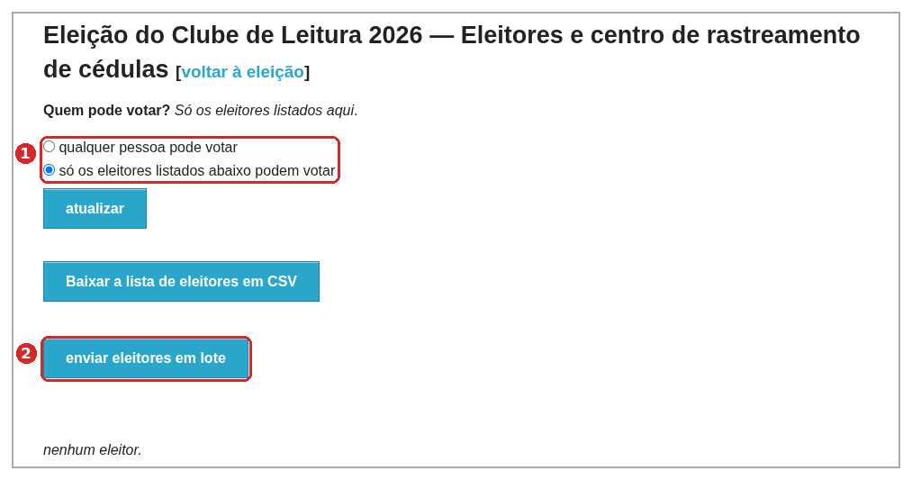
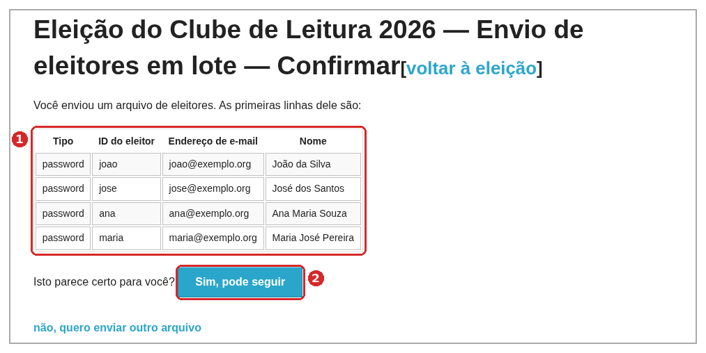
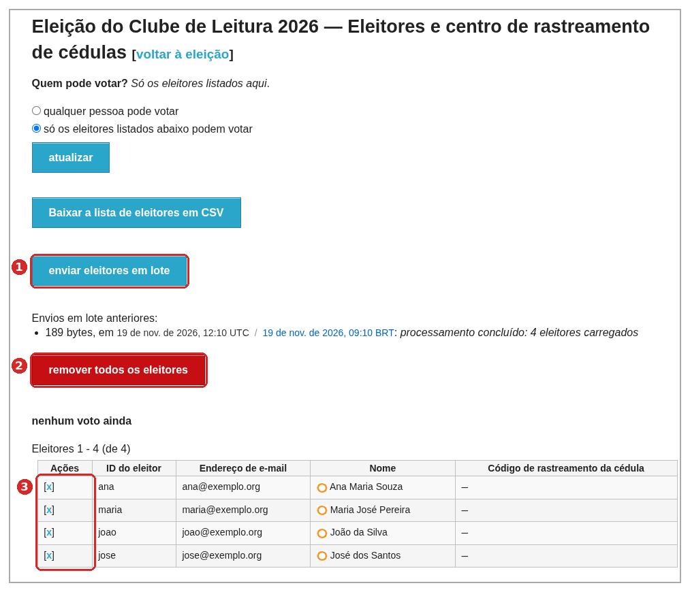
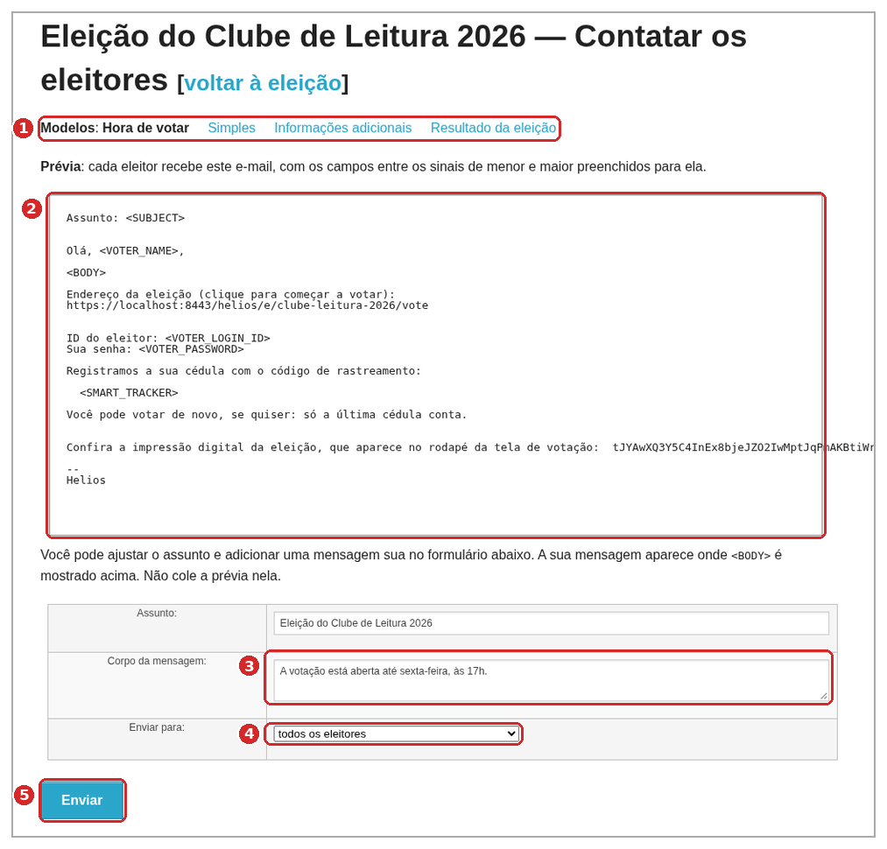

# Gestor 3: Eleitores

Este manual mostra como incluir e remover eleitores, enviar e-mails e lidar com senhas.

## 1. Quem pode votar

Clique em **eleitores e cédulas**. Primeiro escolha quem pode votar. **Isso não muda depois do congelamento.**

- **Qualquer pessoa pode votar:** quem entrar na eleição pode votar.
- **Só os eleitores listados abaixo podem votar:** só quem você incluir na lista.



*Na imagem: (1) **Quem pode votar?** (2) **enviar eleitores em lote**.*

## 2. Incluir eleitores por arquivo CSV

Clique em **enviar eleitores em lote** e envie um arquivo CSV, com um eleitor por linha. A maioria das eleições usa senhas do Helios:

```
password,joao,joao@exemplo.org,João da Silva
password,jose,jose@exemplo.org,José dos Santos
password,ana,ana@exemplo.org,Ana Maria Souza
password,maria,maria@exemplo.org,Maria José Pereira
```

Cada linha tem quatro campos, separados por vírgula:

| Campo | Exemplo | O que é |
|---|---|---|
| Tipo | `password` | `password` usa uma senha do Helios. Outros tipos usam uma conta externa, como `github` ou `ldap` |
| **ID do eleitor** | `joao` | O nome de usuário que você escolhe. Não pode se repetir |
| E-mail | `joao@exemplo.org` | Para onde vão o link e a senha |
| Nome | `João da Silva` | Como o eleitor aparece na lista |

O Helios cria uma senha para cada eleitor `password` e a envia no e-mail (passo 4 deste manual).

Para uma conta externa, escreva o tipo e o nome de usuário, por exemplo `github,benadida`.

**Atenção:**
- O Helios aceita um ID repetido ou com espaço sem avisar. Confira o arquivo antes de enviar.
- Os caracteres do CSV devem estar em **UTF-8**, para os acentos ficarem certos.

Depois de enviar, confira a prévia e clique em **Sim, pode seguir**.



*Na imagem: (1) As primeiras linhas do arquivo enviado. (2) **Sim, pode seguir**.*

## 3. Acompanhar a lista

Os eleitores aparecem na lista, com o nome, o ID, o e-mail e o código de rastreamento (quando votarem).



*Na imagem: (1) **enviar eleitores em lote**. (2) **remover todos os eleitores**. (3) **[x]**, que remove um eleitor.*

Você pode:
- **enviar mais arquivos**, para incluir mais eleitores;
- **remover** um eleitor, no botão da linha dele;
- **remover todos os eleitores**, no botão do topo. O Helios pede confirmação.

Tudo isso vale até a apuração começar, **mesmo com a votação aberta**. Depois, o Helios recusa mudanças na lista.

**Remover um eleitor que já votou** apaga o voto dele. O Helios envia um e-mail ao eleitor avisando que o voto foi removido, e o fato fica no registro da eleição.

## 4. Enviar e-mail aos eleitores

Depois de congelar a urna, clique em **enviar e-mail aos eleitores**.

1. Escolha o **modelo**:

| Modelo | Quando usar |
|---|---|
| **Hora de votar** | A abertura da votação. Traz o link, o ID do eleitor e a senha |
| **Simples** | Um aviso curto, sem os dados de acesso |
| **Informações adicionais** | Uma mensagem com mais detalhes |
| **Resultado da eleição** | Depois de liberar o resultado |

2. A caixa do topo é uma **prévia**. O Helios preenche os dados de cada eleitor nos campos entre sinais de menor e maior. Não cole a prévia no corpo.
3. Para acrescentar um texto seu, escreva-o em **Corpo da mensagem**. Ele aparece no lugar de `<BODY>`.
4. Em **Enviar para**, escolha:
   - **todos os eleitores**;
   - **eleitores que já depositaram a cédula**;
   - **eleitores que ainda não depositaram a cédula** (o lembrete).
5. Clique em **Enviar**.



*Na imagem: (1) Modelos. (2) Prévia do e-mail. (3) **Corpo da mensagem**. (4) **Enviar para**. (5) **Enviar**.*

Para enviar a **um só eleitor**, use o link **e-mail** na linha dele, na lista.

O Helios envia os e-mails em segundo plano. Em listas grandes, eles chegam aos poucos.

## 5. Senhas

- O Helios guarda a senha do eleitor no banco, para poder reenviá-la.
- **Reenviar a senha:** o próprio eleitor clica em **Esqueceu a senha? Clique aqui para receber de novo.** na tela de depositar. Você também pode usar o link **e-mail** na linha dele.
- **Trocar o e-mail de um eleitor:** remova o eleitor e inclua-o de novo, com o e-mail certo. Se ele já votou, o voto se perde, e ele precisa votar de novo.

## Dúvidas comuns

**O eleitor diz que não recebeu o e-mail.** Veja o spam. Confira o e-mail na lista. Reenvie pelo link **e-mail** da linha dele.

**Posso incluir eleitores depois de abrir a votação?** Sim, até a apuração começar. O fato fica no registro da eleição.

**Posso mandar o lembrete só a quem não votou?** Sim: **eleitores que ainda não depositaram a cédula**.

**Quantos eleitores o Helios aguenta?** Nos nossos testes, a apuração leva 80 s com 50.000 eleitores. O envio de e-mails depende do servidor de e-mail.

Voltar ao [índice do gestor](README.md).
