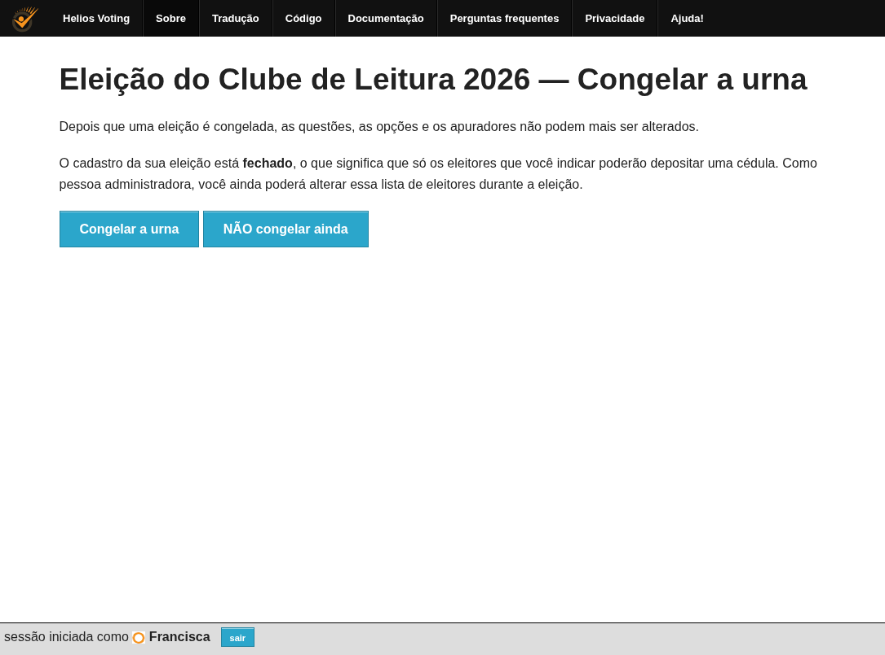
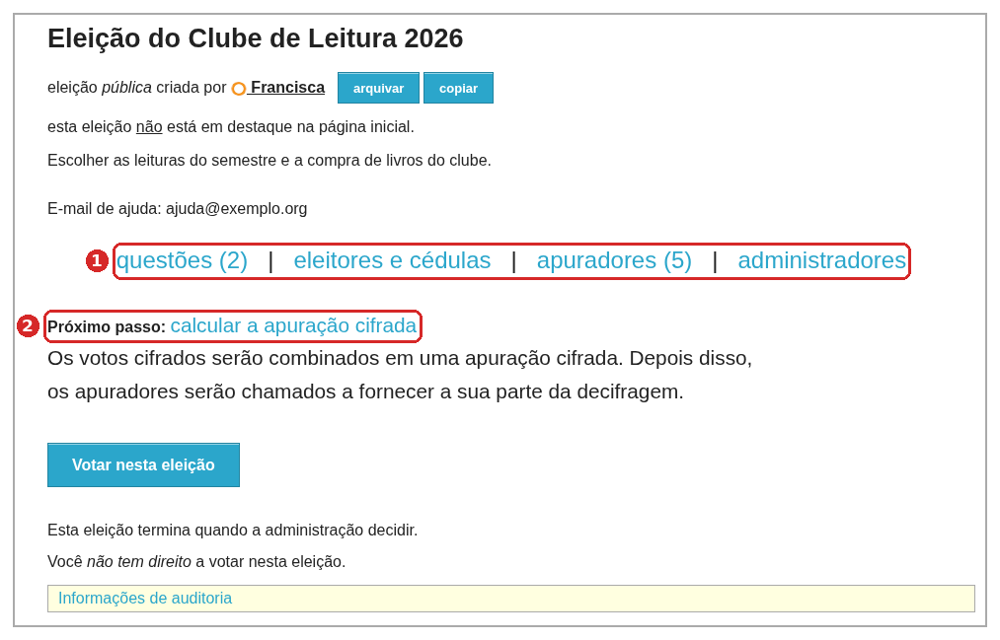

# Gestor 4: Congelar, acompanhar e encerrar

Este manual cobre o meio da eleição: abrir a votação, acompanhá-la e encerrá-la.

## 1. Antes de congelar: confira

Depois de congelada, não dá para mudar as questões, as opções nem os apuradores. Confira:

- [ ] As questões e as opções estão certas, com os limites ("0 a n", "1 a n") que você quer.
- [ ] A lista de eleitores está completa (ela ainda pode mudar depois).
- [ ] Todos os apuradores enviaram a chave pública e **conferiram a chave secreta**. O Helios só deixa congelar quando todos enviaram.
- [ ] As datas de início e de fim estão certas.
- [ ] Existe um e-mail de ajuda.
- [ ] Você viu a **prévia da cabine**, pelo link **prévia da cabine**.

## 2. Congelar a urna e abrir a eleição

1. Na página da eleição, em **Próximo passo**, clique em **congelar a urna e abrir a eleição**.
2. Clique em **Congelar a urna**.

A votação abre na hora, ou no horário de início que você definiu.

Ao congelar, o Helios calcula a **impressão digital da eleição**. Ela aparece em **Informações de auditoria**. **Anote-a e publique-a** no canal oficial da eleição. Os fiscais usam essa impressão digital para conferir que a eleição não mudou.

Depois, envie o e-mail aos eleitores (veja o [manual 3](03-eleitores.md)).

## 3. Enquanto a votação está aberta

A página **eleitores e cédulas** mostra:
- quantos votos foram depositados;
- o código de rastreamento de cada eleitor que votou.

Acompanhe e, perto do fim, envie o lembrete aos eleitores que ainda não votaram.

Você pode:
- **incluir ou remover eleitores**, até a apuração começar;
- **prorrogar a votação**, se definiu uma data de fim. Escolha a nova data e confirme.

O Helios **não mostra** em quem cada pessoa votou, nem para você.

## 4. Encerrar a votação

Você encerra de duas formas:
- **pela data de fim**, que o Helios cumpre sozinho;
- **calculando a apuração cifrada**, na hora que quiser. Isso encerra a votação: ninguém mais deposita cédula.

Depois do fim, a lista de eleitores não muda mais. Passe para o [manual 5](05-apuracao-e-resultado.md).

## O que o Helios não faz

- Quem tenta depositar depois do fim volta à página inicial, **sem aviso**. Avise os eleitores do horário.
- Ele aceita uma data de fim anterior à de início, sem avisar. Confira as datas no formulário.

## Dúvidas comuns

**Posso desfazer o congelamento?** Não. Para mudar as questões, crie outra eleição (**copiar eleição**).

**Posso reabrir a votação depois de encerrar?** Se a eleição tem data de fim, use **prorrogar a votação**. Depois de calcular a apuração, não.

**Posso ver em quem as pessoas estão votando?** Não. As cédulas estão cifradas até a apuração e a decifragem.

Voltar ao [índice do gestor](README.md).
