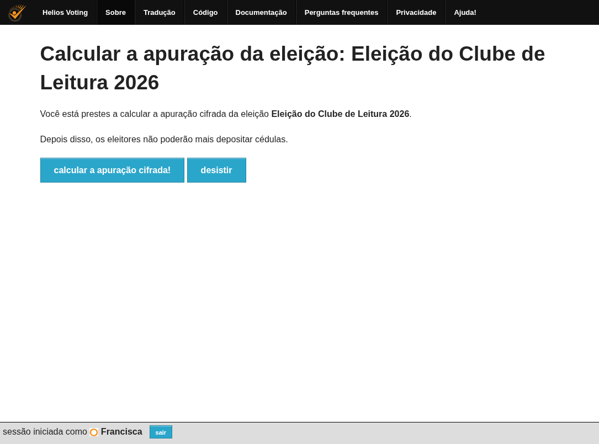
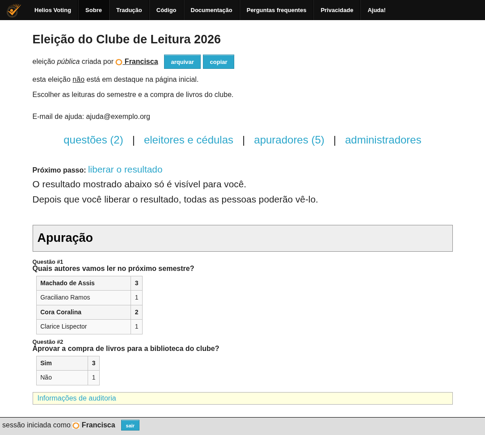
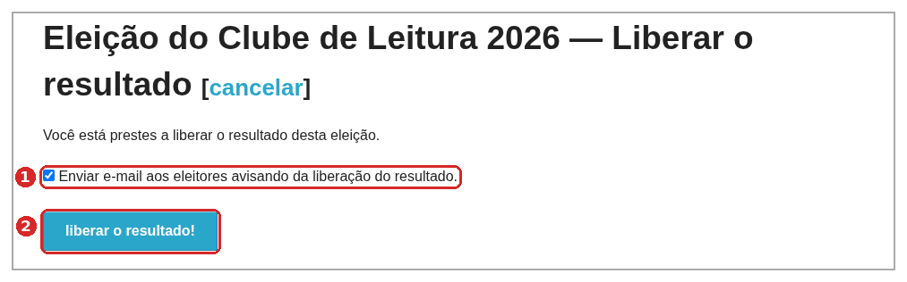
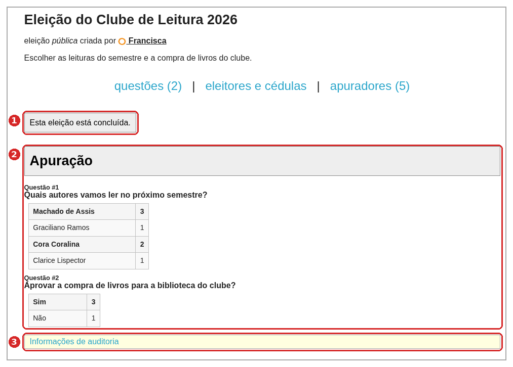

# Gestor 5: Apuração e liberação do resultado

Este manual cobre o fim da eleição: calcular a apuração, esperar os apuradores e liberar o resultado.

## Como a apuração funciona

1. O Helios **soma as cédulas cifradas**, sem decifrar nenhuma. O resultado é a **apuração cifrada**.
2. **Cada apurador** decifra a sua parte. O Helios decifra a dele sozinho, se for apurador.
3. Você **combina as decifragens**. O Helios mostra o resultado só para você.
4. Você **libera o resultado**. Todos o veem.

**Não há quórum.** O resultado só abre quando **todos** os apuradores decifram. Se um apurador perdeu a chave, o resultado não abre. Veja o [manual do apurador](../apurador/02-guardar-a-chave.md).

## 1. Calcular a apuração cifrada

1. Na página da eleição, em **Próximo passo**, clique em **calcular a apuração cifrada**.
2. Clique em **calcular a apuração cifrada!**.

Isso **encerra a votação**: ninguém mais deposita cédula, e a lista de eleitores não muda mais.

O cálculo roda em segundo plano. Em eleições grandes, espere. Nos nossos testes, 50.000 eleitores levaram cerca de 80 s.

## 2. Esperar os apuradores

Se o Helios é o único apurador, ele decifra sozinho, e você pode pular para o passo 3.

Se há outros apuradores:
1. Avise-os de que a apuração cifrada está pronta. Eles já têm o e-mail com o link.
2. Cada um abre o link, clica em **decifrar com a sua chave**, digita a chave secreta e envia a decifragem parcial. Veja o [manual do apurador 3](../apurador/03-decifrar.md).
3. A página **apuradores** da eleição mostra quem já enviou e quem ainda **aguarda**.

Acompanhe e cobre quem falta. A eleição fica parada até todos enviarem.

## 3. Combinar as decifragens

Quando todos os apuradores tiverem decifrado, o link **combinar as decifragens** aparece em **Próximo passo**.

1. Clique em **calcular os resultados**.
2. Clique em **calcular a apuração!**.

O resultado aparece **só para você**.

**Se o Helios recusar** ("as decifragens parciais dos apuradores não decifram a apuração"), algum apurador enviou a decifragem de outra apuração, ou a de outra eleição. Peça ao apurador que decifre de novo, com a apuração atual.

## 4. Liberar o resultado

1. Confira o resultado.
2. Clique em **liberar o resultado**.
3. Deixe marcada a caixa para **enviar e-mail aos eleitores**, se quiser avisá-los.
4. Clique em **liberar o resultado!**.

Agora todos veem o resultado na página da eleição.

## 5. Depois de liberar

- **Fiscais** podem [verificar a eleição inteira](../fiscal/01-verificar-eleicao.md).
- **Guarde** a impressão digital da eleição e o endereço do resultado.
- O resultado mostra a contagem de **cada opção**. Ele **não mostra** quantos votaram em branco. Veja o [manual 2](02-questoes.md).

## Dúvidas comuns

**Um apurador não responde.** Reenvie o link dele (botão **enviar o acesso**, na página **apuradores**) e cobre. Se ele perdeu a chave, não há recuperação.

**Posso mudar o resultado?** Não. Ele é a soma das cédulas, e qualquer pessoa pode conferi-la.

**O resultado deu errado.** O Helios confere as provas das decifragens. Um resultado que passa por elas é o resultado das cédulas.

Voltar ao [índice do gestor](README.md).
