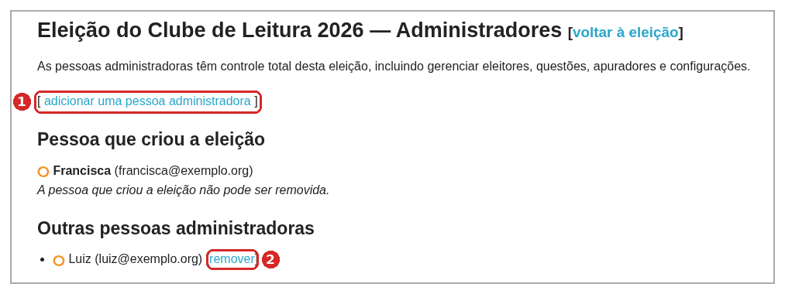

# Gestor 6: Outros administradores

Quem cria a eleição é o primeiro administrador. Você pode dar o mesmo controle a mais pessoas.

## O que um administrador pode fazer

Gerenciar a eleição inteira: eleitores, questões, apuradores e configurações.

## Incluir um administrador

1. Na página da eleição, clique em **administradores**. A página se chama **Administradores de _nome_**.
2. Clique em **adicionar uma pessoa administradora**.
3. Digite o **login** da pessoa.

A pessoa precisa ter **entrado no Helios pelo menos uma vez**. Se ela nunca entrou, o Helios não a encontra.

*Na imagem: (1) **adicionar uma pessoa administradora**. (2) **remover**.*

## Remover um administrador

Na mesma página, use o botão de remover, na linha da pessoa. **Quem criou a eleição não pode ser removido.**

## Cuidados

- Um administrador pode **calcular a apuração e liberar o resultado**. Dê esse acesso só a quem é de confiança.
- O Helios guarda o **registro** das ações da eleição. Um administrador pode baixá-lo, em **Informações de auditoria**, no link **Baixar o registro da eleição (CSV)**.
- Um administrador **não vê** em quem as pessoas votaram, e não decifra o resultado sem os apuradores.

## Dúvidas comuns

**Quantos administradores posso ter?** Quantos quiser. Nos nossos testes, de 1 a 10 administradores não mudaram o desempenho.

**O administrador novo precisa de senha?** Não de uma senha da eleição. Ele entra no Helios do jeito de sempre.

**Posso dar acesso só para ver?** Não. O Helios não tem um papel só de leitura.

Voltar ao [índice do gestor](README.md).
