# Manual do Helios

> **Tradução não oficial.** Este texto vem do fork
> [helios-ptbr/helios-server](https://github.com/helios-ptbr/helios-server),
> que traduz o Helios para o português do Brasil. Ele não foi escrito nem
> revisado por Ben Adida. Em caso de dúvida, vale o original em inglês:
> [User Manual](../user-manual.md)
> ([no repositório de Ben Adida](https://github.com/benadida/helios-server/blob/master/docs/user-manual.md)).

Este guia percorre uma eleição inteira: criar a eleição, incluir eleitores, abri-la, votar e publicar o resultado. A última parte é um guia para
quem vota.

As imagens vêm de uma eleição de exemplo, a "Eleição do Clube de Leitura 2026",
e mostram a interface em português. Ela foi criada por Francisca, com Luiz como
outro administrador, tem quatro eleitores (João da Silva, José dos Santos, Ana
Maria Souza e Maria José Pereira) e quatro apuradores: Paulo, Gabriel, Juliana e
Antônia, além do Helios. As opções são autores brasileiros: Machado de Assis,
Graciliano Ramos, Cora Coralina e Clarice Lispector. Seu servidor pode oferecer
outras opções de login e outro visual (logo e cores).

## Parte 1: Administrar uma eleição

### 1. Entre

Entre no seu servidor Helios. Depois do login, a página inicial mostra
**criar eleição**, além das eleições que você administra e das que você votou.

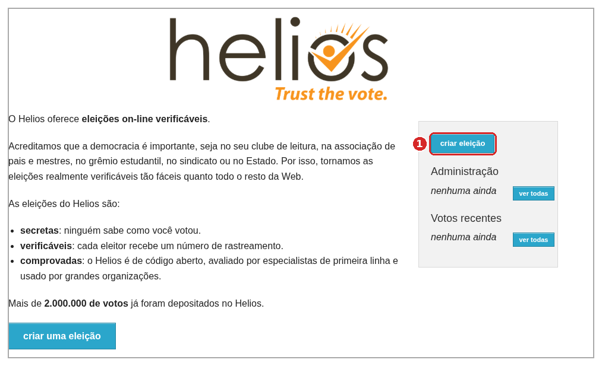

*Na imagem: (1) **criar eleição**.*

### 2. Crie a eleição

Clique em **criar eleição** e preencha o formulário:

- **Nome curto:** uma palavra, sem espaços. Ele passa a fazer parte do endereço
  da eleição, por exemplo `/helios/e/clube-leitura-2026`.
- **Nome** e **Descrição:** o que os eleitores vão ver.
- **Tipo:** Eleição ou Consulta.
- **Usar apelidos de eleitores:** mostra as pessoas como "V12" e
  assim por diante no centro de rastreamento de cédulas público, no lugar dos
  nomes.
- **Ordem aleatória das opções:** mostra as opções em ordem aleatória para cada
  eleitor.
- **Privada?:** só os eleitores da sua lista podem ver a eleição.
- **E-mail de ajuda:** para onde os eleitores podem pedir ajuda.
- **Início da votação / Fim da votação:** opcionais. Você digita o horário do
  fuso do seu navegador, e o Helios converte para UTC. Deixe em branco para
  abrir a votação assim que você congelar a urna (passo 6) e encerrá-la você
  mesma ou você mesmo.

Clique em **Próximo**. Você chega à página da eleição, que sempre mostra o
**Próximo passo**.

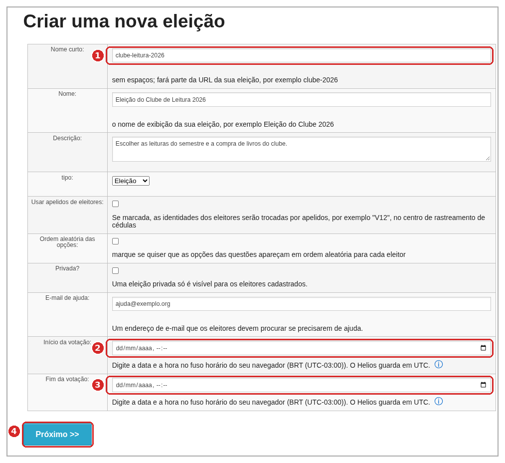

*Na imagem: (1) **Nome curto**. (2) **Início da votação**, opcional. (3) **Fim da votação**, opcional. (4) **Próximo**.*

### 3. Inclua as questões

Clique em **questões**. Em cada questão, digite o texto, quantas opções a
pessoa pode escolher ("Seleção: 0 a 2") e as opções. Clique em **Adicionar a
questão**.

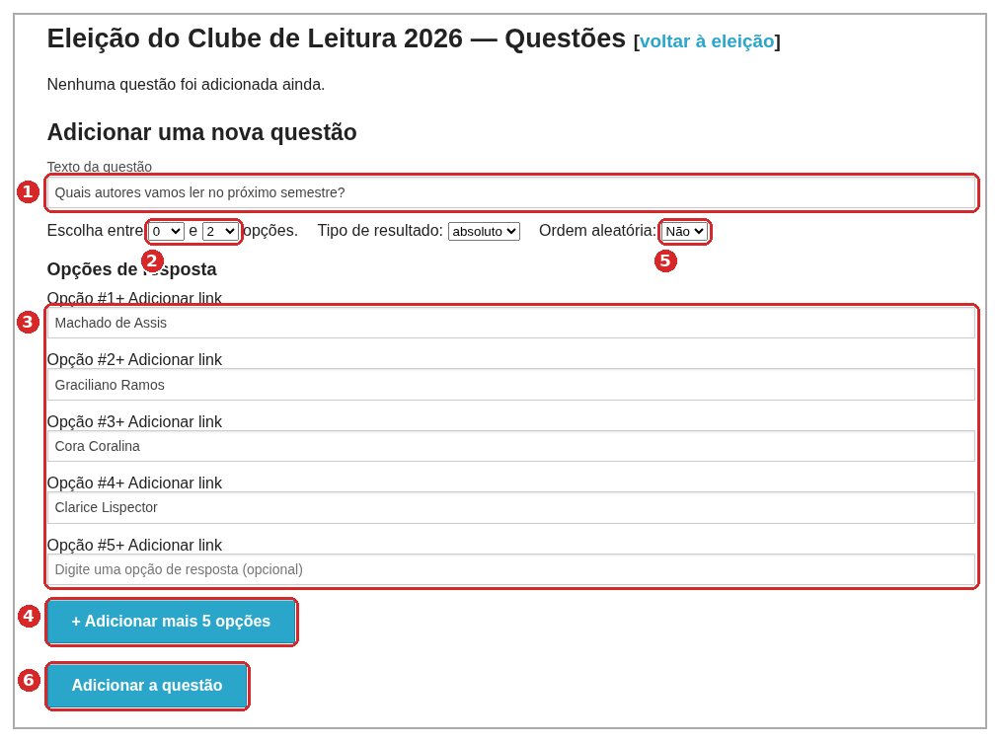

*Na imagem: (1) Texto da questão. (2) **Escolha entre _X_ e _Y_ opções**. (3) Opções de resposta. (4) **Adicionar mais 5 opções**. (5) **Ordem aleatória**. (6) **Adicionar a questão**.*

Você pode editar, remover e reordenar as questões até congelar a eleição.

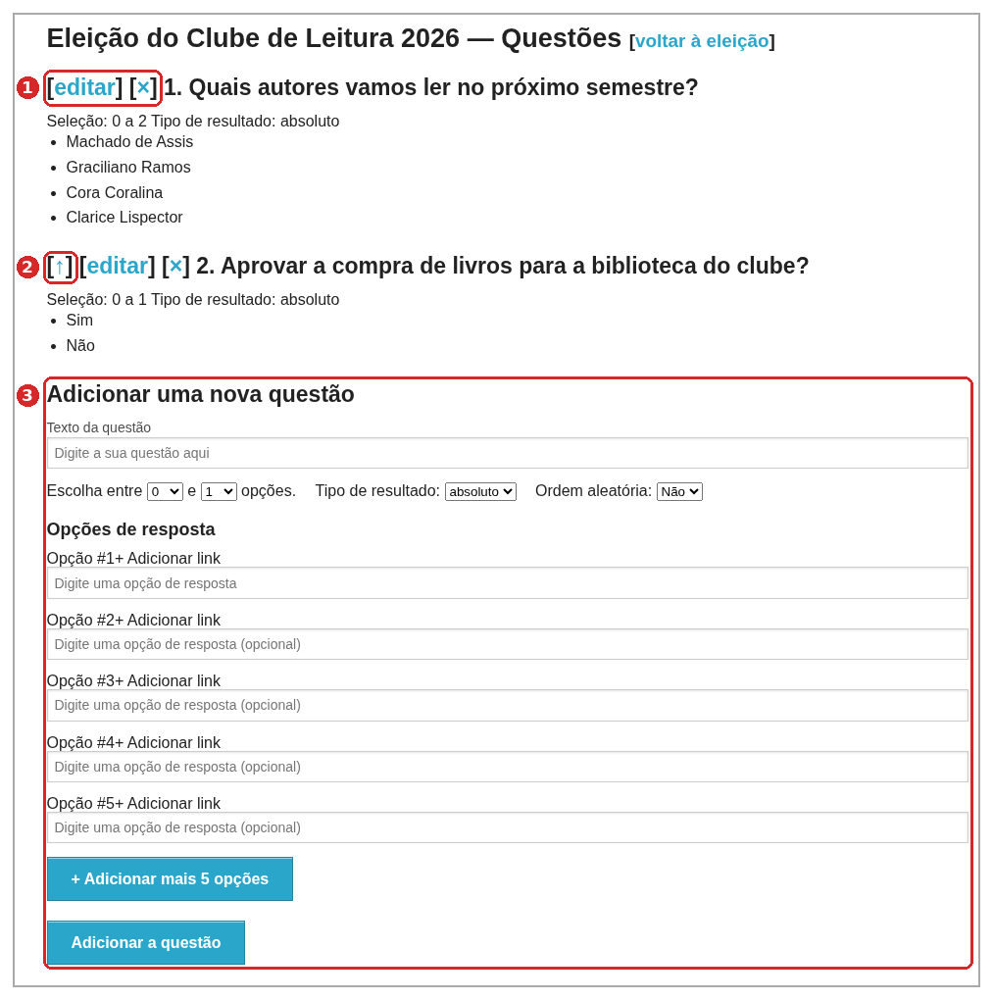

*Na imagem: (1) **editar** e **×**, que editam e removem a questão. (2) **↑**, que sobe a questão. (3) Formulário de uma nova questão.*

### 4. Inclua os eleitores

Clique em **eleitores e cédulas**. Primeiro escolha quem pode votar
(isso não muda depois do congelamento):

- **qualquer pessoa pode votar:** qualquer pessoa que entrar pode votar.
- **só os eleitores listados abaixo podem votar:** só as pessoas que
  você enviar.

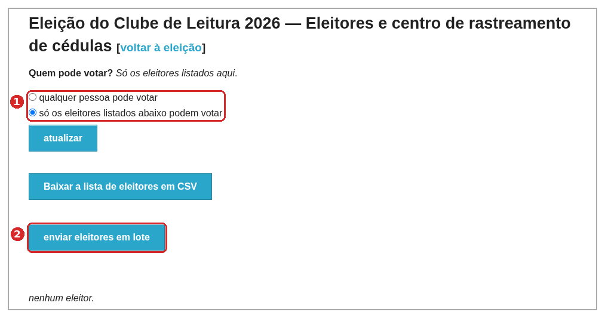

*Na imagem: (1) **Quem pode votar?** (2) **enviar eleitores em lote**.*

Para incluir eleitores, clique em **enviar eleitores em lote**
e envie um arquivo CSV, com uma pessoa por linha. A maioria das eleições usa
senhas do Helios:

```
password,joao,joao@exemplo.org,João da Silva
password,jose,jose@exemplo.org,José dos Santos
password,ana,ana@exemplo.org,Ana Maria Souza
password,maria,maria@exemplo.org,Maria José Pereira
```

Os campos são: `password`, um ID do eleitor que você escolhe, o e-mail da pessoa e o
nome dela. O Helios cria uma senha para cada pessoa e a envia por e-mail no
passo 7. Para usar uma conta de login externa, escreva o tipo de login e o
nome de usuário, por exemplo `github,benadida`.

Confira a prévia e clique em **Sim, pode seguir**.

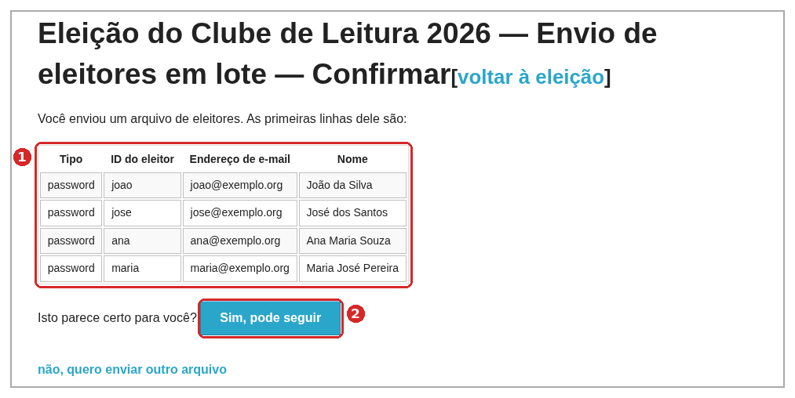

*Na imagem: (1) As primeiras linhas do arquivo enviado. (2) **Sim, pode seguir**.*

Os eleitores agora aparecem na lista. Você pode enviar mais arquivos e
remover pessoas até calcular a apuração, mesmo com a votação aberta.

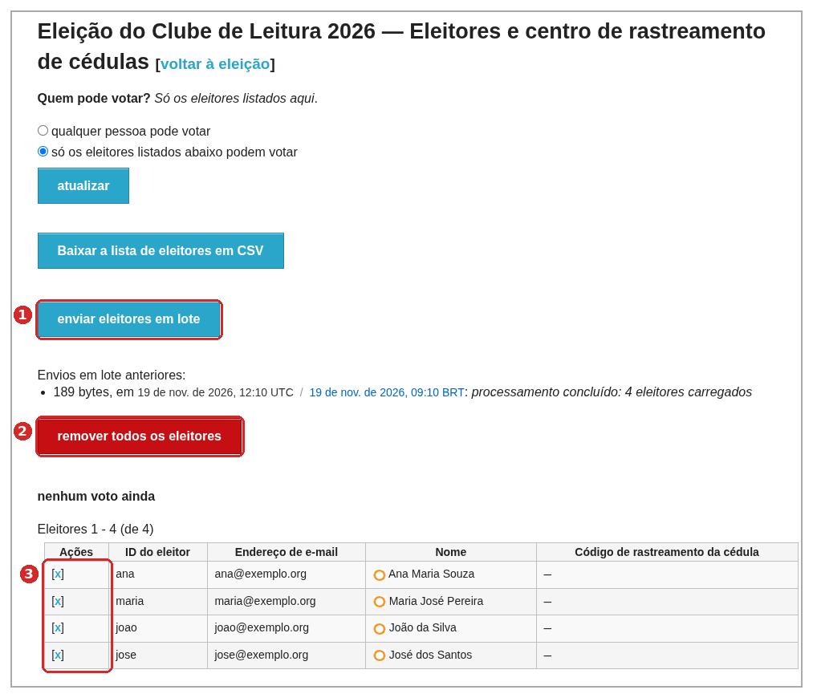

*Na imagem: (1) **enviar eleitores em lote**. (2) **remover todos os eleitores**. (3) **[x]**, que remove um eleitor.*

### 5. Apuradores (opcional)

Clique em **apuradores**. Os apuradores guardam as chaves que decifram o resultado. Por padrão, o
Helios é o único apurador e cuida disso por você, então você pode pular
este passo.

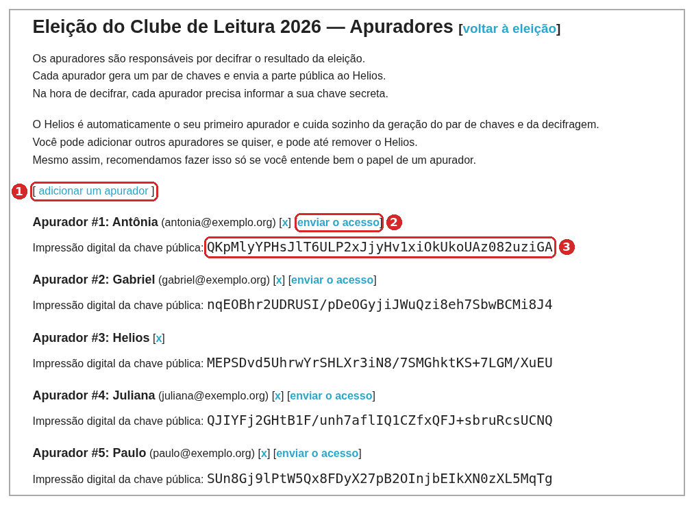

*Na imagem: (1) **adicionar um apurador**. (2) **enviar o acesso**. (3) Impressão digital da chave pública.*

Na imagem, os apuradores são o Helios e mais quatro pessoas (Paulo, Gabriel,
Juliana e Antônia). Cada um já enviou a chave pública, e a página mostra a
impressão digital da chave.

Para ter mais proteção, inclua apuradores em **adicionar um apurador** (nome e e-mail) e clique em **enviar o acesso** para mandar a cada
um o seu link. Cada apurador abre o link, clica em **configurar a sua
chave**, gera uma chave, guarda o arquivo da chave secreta em um lugar seguro e
envia a chave pública. Você também pode remover o apurador do Helios,
para que ninguém consiga decifrar o resultado sem os seus apuradores.

Você só consegue congelar a eleição quando todos os apuradores tiverem
enviado a chave pública. Decifrar o resultado exige todos: se um perder
a chave secreta, o resultado não pode ser decifrado.

### 6. Congele a eleição

Quando a cédula e os apuradores estiverem prontos, clique em **congelar
a urna e abrir a eleição** em Próximo passo e depois em **Congelar a urna**.

Depois do congelamento, as questões, as opções e os apuradores não
mudam mais. Você ainda pode mudar a lista de eleitores. A votação abre
na hora, ou no horário de início que você definiu.

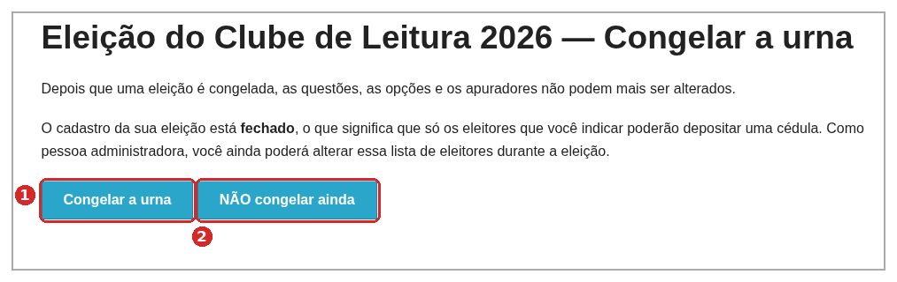

*Na imagem: (1) **Congelar a urna**. (2) **NÃO congelar ainda**.*

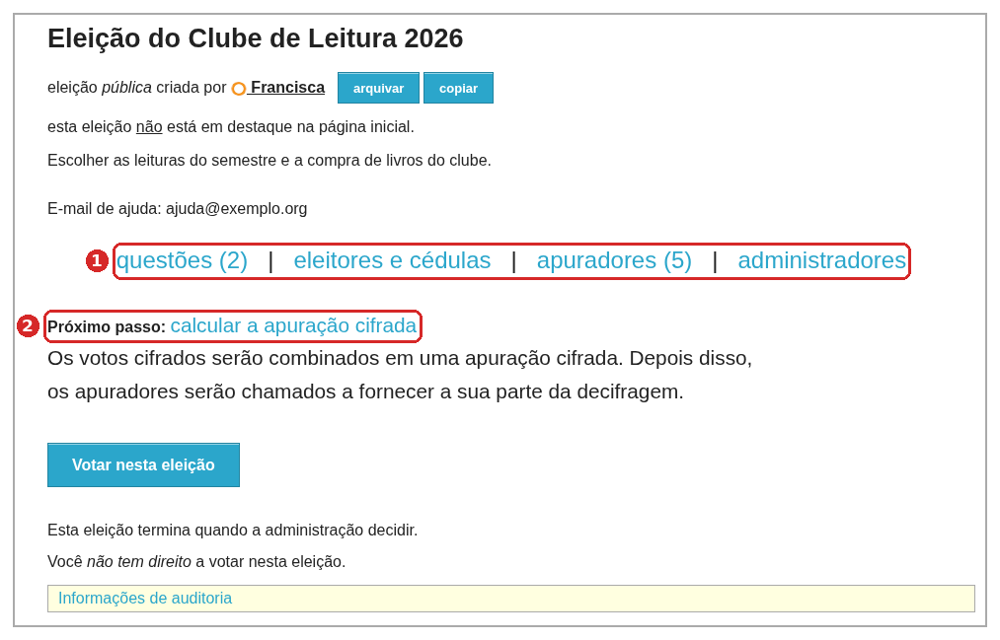

*Na imagem: (1) Menu da eleição. (2) **Próximo passo**.*

### 7. Envie e-mail aos eleitores

Na página **eleitores e cédulas**, clique em **enviar e-mail aos eleitores**. O modelo **Hora de votar** envia a cada pessoa o link de votação
e, para quem usa senha, o ID do eleitor e a senha.

A caixa do topo é uma prévia. O Helios preenche os dados de cada pessoa nos
campos mostrados entre sinais de menor e maior. Para acrescentar um texto seu,
escreva-o em **Corpo da mensagem**: ele aparece no lugar de `<BODY>`. Não cole
a prévia ali. Escolha quem recebe e clique em **Enviar**.

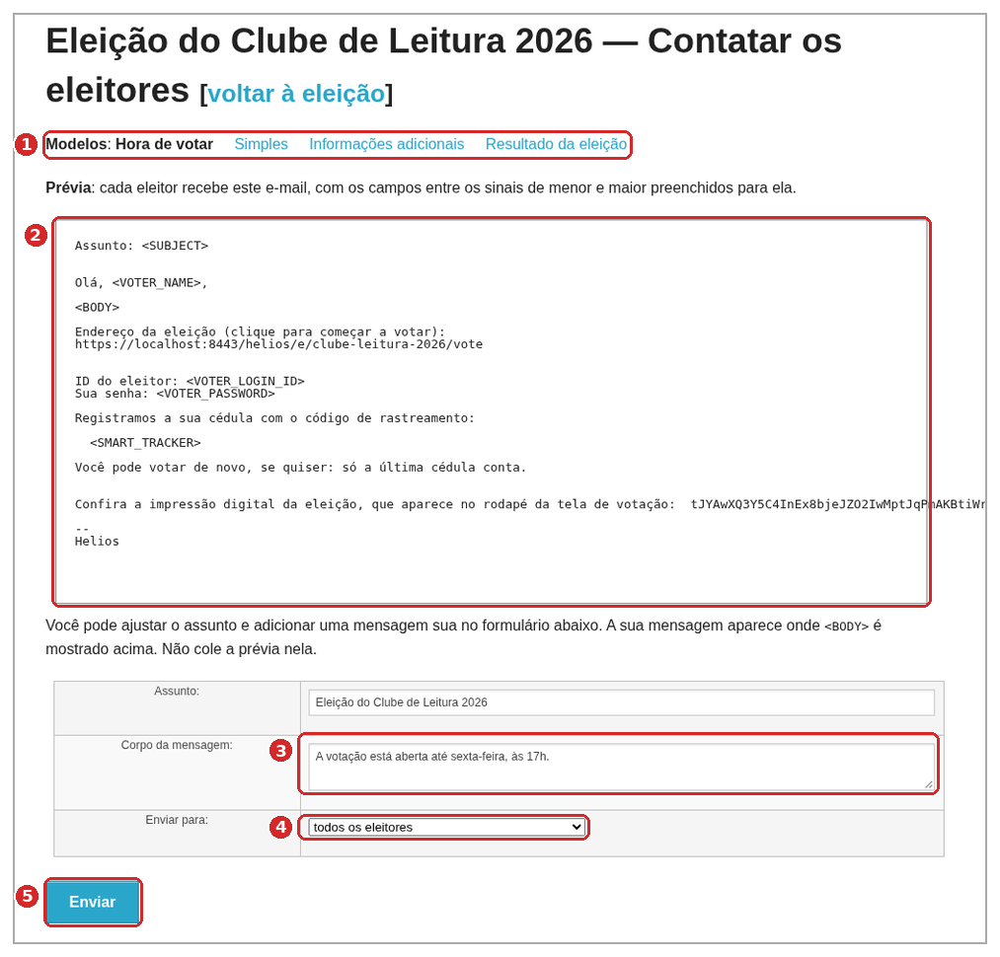

*Na imagem: (1) Modelos. (2) Prévia do e-mail. (3) **Corpo da mensagem**. (4) **Enviar para**. (5) **Enviar**.*

Depois, você pode usar a mesma página para lembrar só as pessoas que ainda não
votaram.

### 8. Enquanto a votação está aberta

A página **eleitores e cédulas** mostra quantos votos foram depositados e
o código de rastreamento de cada pessoa. Se você definiu um horário de fim,
pode **prorrogar a votação** até calcular a apuração.

### 9. Encerre a votação e calcule a apuração

Quando quiser parar a votação, clique em **calcular a apuração cifrada** em
Próximo passo e depois em **calcular a apuração cifrada!**. Isso encerra a
votação: ninguém mais consegue depositar cédula.

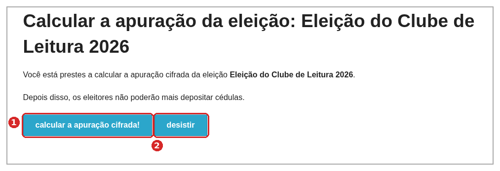

*Na imagem: (1) **calcular a apuração cifrada!** (2) **desistir**.*

O Helios soma as cédulas cifradas sem decifrar nenhuma. Se o Helios é apurador, ele decifra a sua parte automaticamente. Os outros apuradores
agora abrem o seu link, clicam em decifrar com a sua chave, digitam a chave
secreta e enviam a decifragem parcial.

### 10. Calcule e libere o resultado

Quando todos os apuradores tiverem decifrado, clique em **calcular os
resultados** em Próximo passo e depois em **calcular a apuração!**. O
resultado agora aparece só para você.

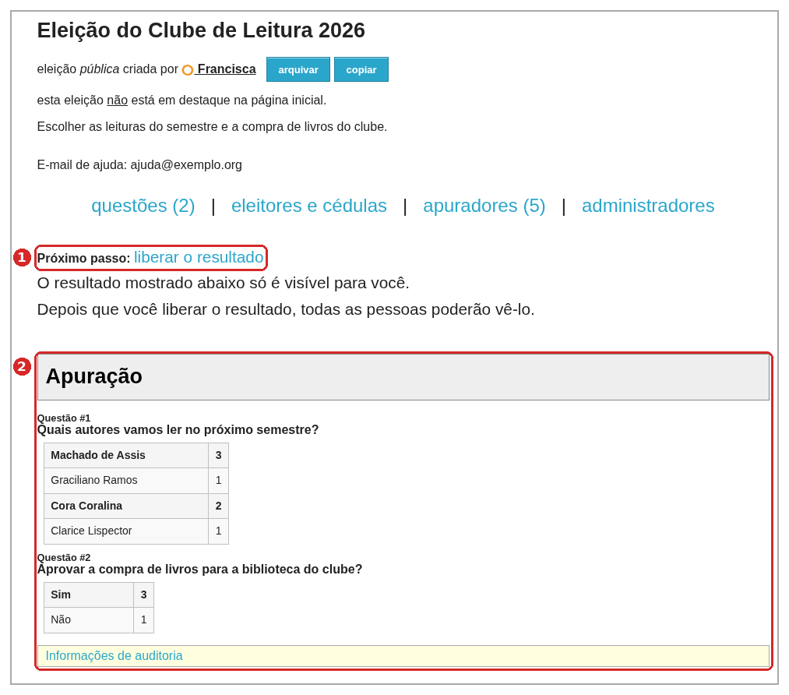

*Na imagem: (1) **Próximo passo**: liberar o resultado. (2) Apuração, visível só para quem administra.*

Confira e clique em **liberar o resultado**. Deixe a caixa marcada para enviar
e-mail aos eleitores e clique em **liberar o resultado!**.

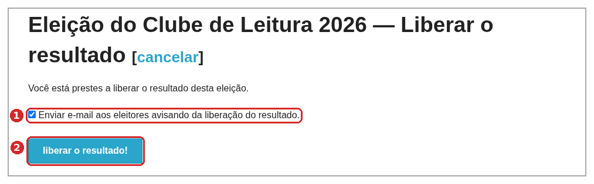

*Na imagem: (1) Aviso por e-mail aos eleitores. (2) **liberar o resultado!***

Agora todas as pessoas veem o resultado na página da eleição.

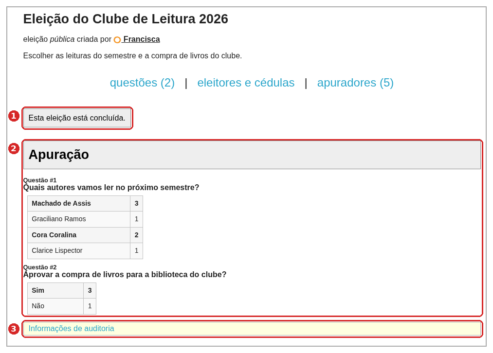

*Na imagem: (1) Aviso de eleição concluída. (2) Apuração. (3) **Informações de auditoria**.*

### Outros administradores (opcional)

Clique em **administradores** para ver quem administra a eleição. Quem criou a
eleição não pode ser removida. Para dar a mais alguém o mesmo controle (eleitores,
questões, apuradores e configurações), clique em **adicionar uma pessoa
administradora** e digite o login dela. A pessoa precisa ter entrado no Helios
pelo menos uma vez.

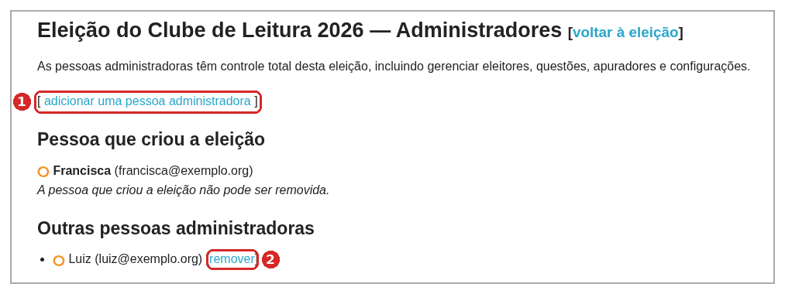

*Na imagem: (1) **adicionar uma pessoa administradora**. (2) **remover**.*

## Parte 2: Guia para quem vota

### 1. Seu e-mail

Você recebe um e-mail como este:

```
Olá, João da Silva,

A votação está aberta até sexta-feira, às 17h.

Endereço da eleição (clique para começar a votar):
https://votacao.exemplo.org/helios/e/clube-leitura-2026/vote

ID do eleitor: joao
Sua senha: usyWtLo2yW
```

Guarde o e-mail: você vai precisar do ID do eleitor e da senha para depositar a cédula.
Algumas eleições pedem que você entre com uma conta, como Google ou GitHub.

### 2. Preencha a cédula

Clique no link do e-mail. A cabine de votação abre. Clique em **Iniciar**.

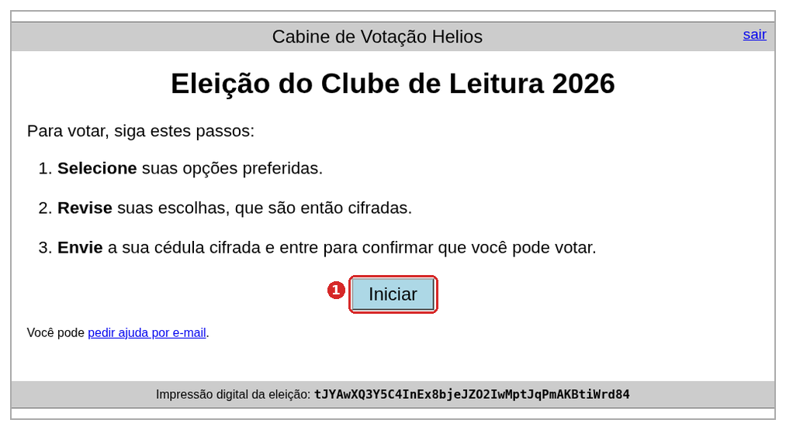

*Na imagem: (1) **Iniciar**.*

Marque as respostas de cada questão e clique em **Próximo** (**Prosseguir**
depois da última questão). A cabine diz quantas opções você pode escolher.

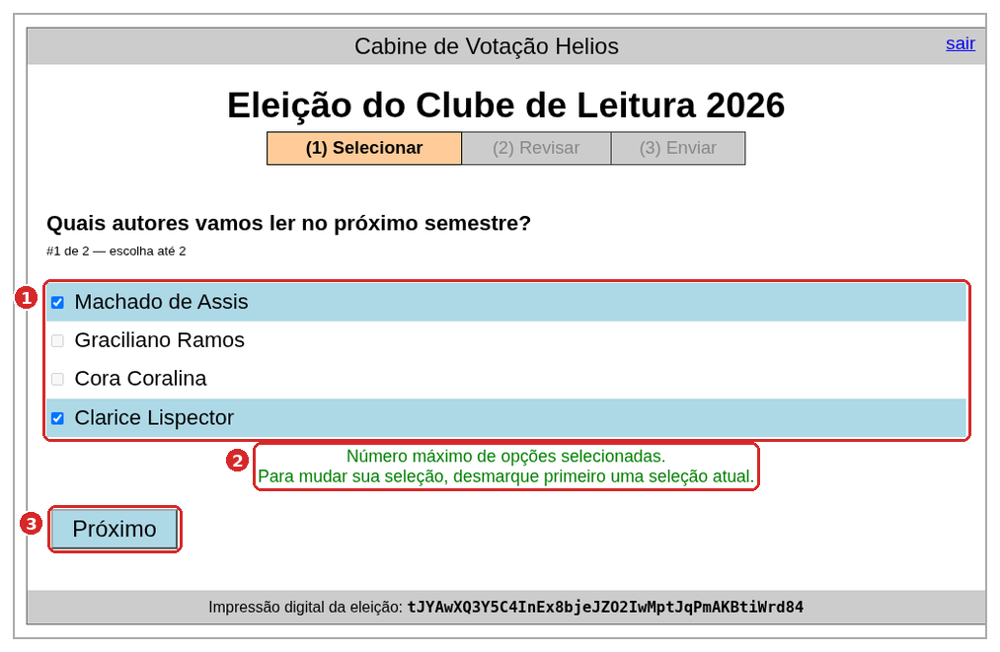

*Na imagem: (1) Opções marcadas. (2) Aviso de máximo de opções. (3) **Próximo**.*

### 3. Revise e cifre

A cabine mostra as suas escolhas. Clique em **[alterar]** para corrigir uma
questão.

Em seguida, o navegador cifra a cédula e mostra o seu **código de
rastreamento**, um código longo como `Ag/lQORWPk...`. Anote-o ou deixe a
página aberta. Clique em **Prosseguir para o login**.

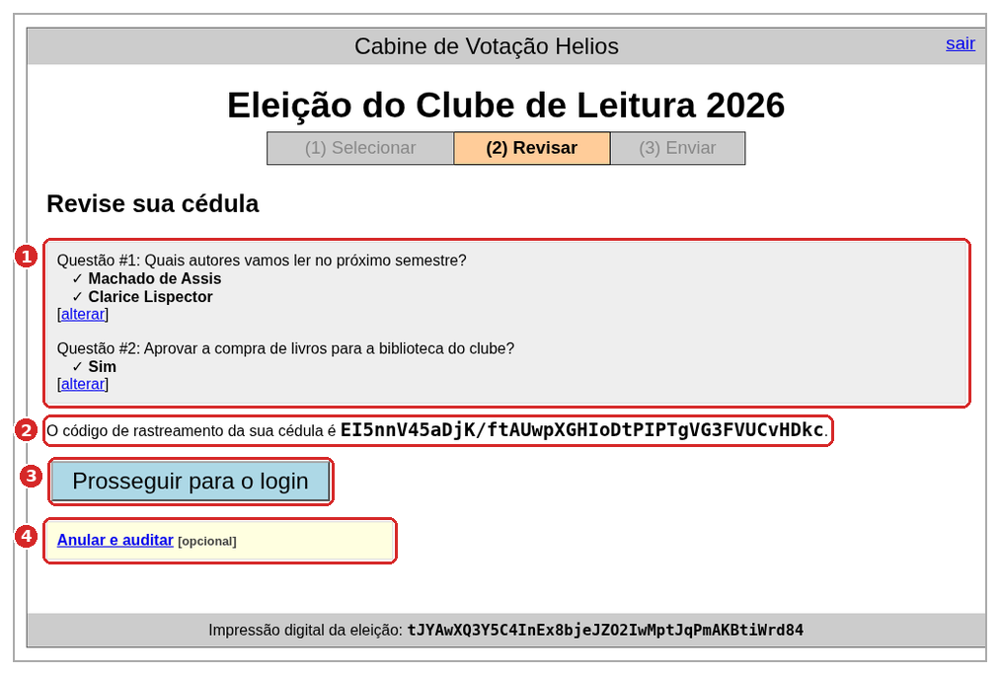

*Na imagem: (1) Resumo da cédula. (2) Código de rastreamento. (3) **Prosseguir para o login**. (4) **Anular e auditar**.*

**Anular e auditar** é opcional. Com isso você confere se a cabine cifrou as
suas escolhas corretamente, mas essa cédula é descartada e você começa de novo.
A auditoria mostra as suas escolhas, e, se você publicar a cédula auditada,
qualquer pessoa pode vê-las.

### 4. Deposite a cédula

A sua cédula ainda não foi depositada. Digite o ID do eleitor e a senha do e-mail e
clique em **autenticar & depositar a cédula**.

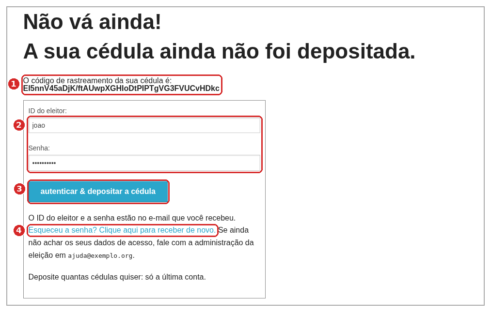

*Na imagem: (1) Código de rastreamento da sua cédula. (2) **ID do eleitor** e **Senha**. (3) **autenticar & depositar a cédula**. (4) **Esqueceu a senha?***

Perdeu a senha? Clique em **Esqueceu a senha? Clique aqui para receber de
novo.**

Se você entrou com uma conta, clique em **DEPOSITAR esta cédula**.

### 5. Pronto

Você vê **Voto depositado com sucesso!** e o seu código de rastreamento. O Helios
também envia o código por e-mail.

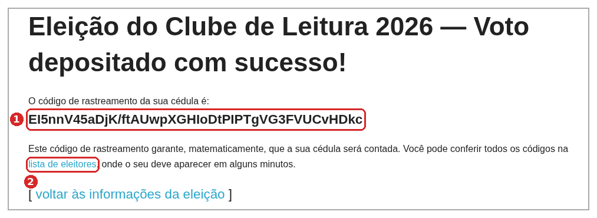

*Na imagem: (1) Código de rastreamento da sua cédula. (2) **lista de eleitores**.*

### 6. Confira a sua cédula

Abra a página da eleição e clique em **eleitores e cédulas**. Em alguns
minutos, o seu código de rastreamento aparece ao lado do seu nome (ou do seu
apelido). Se ele for igual ao que você anotou, a sua cédula foi registrada como
você a depositou.

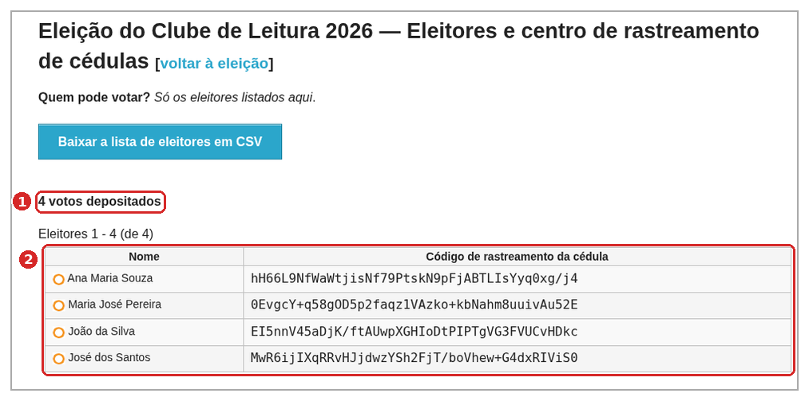

*Na imagem: (1) Número de votos depositados. (2) Código de rastreamento de cada cédula.*

### Votar de novo

Você pode votar de novo enquanto a votação estiver aberta. Só vale a sua
última cédula.

### Ver o resultado

Quando quem administra libera o resultado, ele aparece na página da eleição, e
você pode receber um e-mail.
